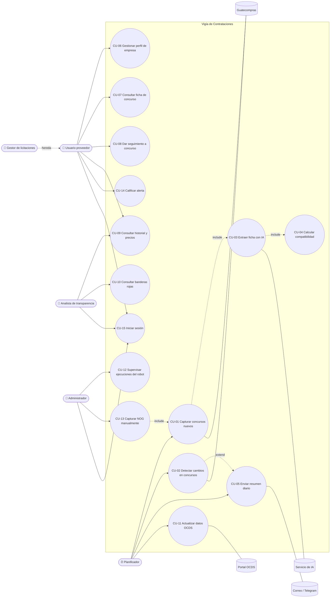

# 04 · Casos de uso

## 4.1 Actores

| Actor | Tipo | Descripción |
|---|---|---|
| **Usuario proveedor** | Primario, humano | Empleado o dueño de la MiPyme que recibe alertas y consulta concursos |
| **Gestor de licitaciones** | Primario, humano | Hereda del usuario proveedor; administra varios perfiles de empresa |
| **Analista de transparencia** | Primario, humano | Consulta banderas rojas e historial de proveedores |
| **Administrador** | Primario, humano | Configura el sistema, supervisa el robot y los costos de IA |
| **Planificador** | Primario, sistema | Dispara las ejecuciones programadas |
| **Guatecompras** | Secundario, sistema externo | Portal web del que el robot captura información |
| **Portal OCDS** | Secundario, sistema externo | Fuente de datos abiertos |
| **Servicio de IA (LLM)** | Secundario, sistema externo | Extrae fichas estructuradas |
| **Correo / Telegram** | Secundario, sistema externo | Canales de notificación |

## 4.2 Diagrama de casos de uso

## 4.3 Especificación de casos de uso

### CU-01 · Capturar concursos nuevos

| Campo | Detalle |
|---|---|
| **Actor principal** | Planificador |
| **Actores secundarios** | Guatecompras, Servicio de IA |
| **Descripción** | El robot busca en Guatecompras los concursos publicados desde la última ejecución, registra sus datos y descarga sus documentos. |
| **Precondiciones** | Hay al menos un perfil de empresa activo con filtros. Existe registro de la última ejecución exitosa (o se usa la fecha de hoy). |
| **Postcondiciones** | Los concursos nuevos quedan registrados con estado `CAPTURADO`, con documentos descargados y en cola para extracción. La ejecución queda en bitácora. |
| **Requerimientos** | RF-CAP-01 a 05, RF-CAP-08, RF-CAP-09 |

**Flujo principal**

1. El planificador (Time Trigger de UiPath Orchestrator) inicia la ejecución a la hora configurada.
2. El robot registra el inicio de la ejecución en la bitácora.
3. El robot obtiene la unión de filtros de todos los perfiles activos (modalidades, categorías, entidades).
4. El robot abre el buscador de concursos de Guatecompras.
5. El robot aplica los filtros y el rango de fechas desde la última ejecución.
6. El robot recorre todas las páginas de resultados y obtiene la lista de NOG.
7. Para cada NOG que no exista en la base de datos:
   1. Abre el detalle del concurso.
   2. Extrae los datos generales (RF-CAP-03).
   3. Obtiene la lista de documentos adjuntos.
   4. Descarga cada documento, calcula su hash y lo almacena.
   5. Registra el concurso con estado `CAPTURADO`.
   6. Encola el concurso para extracción con IA (**include CU-03**).
8. El robot registra el fin de la ejecución con su resumen.

**Flujos alternos**

| ID | Condición | Acción |
|---|---|---|
| FA-1 | Guatecompras no responde en el paso 4 | Reintentar con espera exponencial (3 intentos). Si persiste, marcar la ejecución como `FALLIDA` y notificar al administrador (RF-NOT-05). |
| FA-2 | Un concurso individual falla en el paso 7 | Guardar captura de pantalla y HTML, registrar el error y continuar con el siguiente NOG (RNF-06). |
| FA-3 | No hay concursos nuevos | Registrar la ejecución como `EXITOSA` con 0 concursos. |
| FA-4 | Un selector no encuentra el elemento esperado | Registrar error de tipo `CAMBIO_ESTRUCTURA`, notificar al administrador con la captura. |
| FA-5 | Un documento ya existe (mismo hash) | No volver a descargarlo; enlazar el existente. |

---

### CU-02 · Detectar cambios en concursos

| Campo | Detalle |
|---|---|
| **Actor principal** | Planificador |
| **Actor secundario** | Guatecompras |
| **Descripción** | El robot revisa los concursos abiertos que algún usuario sigue y detecta aclaraciones, adendas o cambios de fecha y estado. |
| **Precondiciones** | Existen concursos con estado de seguimiento y fecha de cierre no vencida. |
| **Postcondiciones** | Los cambios quedan registrados en el historial del concurso; los usuarios que lo siguen reciben alerta inmediata. |
| **Requerimientos** | RF-CAP-06, RF-NOT-03, RN-05 |

**Flujo principal**

1. El planificador inicia la revisión (después de CU-01).
2. El robot obtiene la lista de concursos en seguimiento con cierre no vencido.
3. Para cada concurso, abre su detalle y compara contra la última versión guardada: estado, fecha de cierre, cantidad de documentos y de aclaraciones.
4. Si hay documentos nuevos, los descarga y los envía a la IA para resumir el cambio (RF-IA-05).
5. Registra cada cambio en el historial.
6. Envía alerta inmediata a los usuarios que siguen el concurso (**extend CU-05**).

**Flujos alternos**

| ID | Condición | Acción |
|---|---|---|
| FA-1 | No hay cambios | Actualizar la fecha de última revisión y continuar. |
| FA-2 | El concurso pasó a adjudicado, desierto o anulado | Registrar el nuevo estado, notificar y quitarlo de la revisión diaria. |

---

### CU-03 · Extraer ficha con IA

| Campo | Detalle |
|---|---|
| **Actor principal** | Sistema (cola de trabajos) |
| **Actor secundario** | Servicio de IA |
| **Descripción** | Convierte el texto de las bases de un concurso en una ficha estructurada y un resumen. |
| **Precondiciones** | El concurso tiene al menos un documento descargado. |
| **Postcondiciones** | El concurso tiene una ficha validada con estado `ANALIZADO`, o la marca `REVISION_MANUAL`. |
| **Requerimientos** | RF-DOC-01 a 04, RF-IA-01 a 04, RN-06 |

**Flujo principal**

1. El sistema toma el concurso de la cola.
2. Extrae el texto de cada documento; si no tiene texto digital, aplica OCR.
3. Identifica las secciones relevantes y arma el contexto para la IA.
4. Envía el contexto al servicio de IA con el esquema de la ficha.
5. Valida la respuesta contra el esquema.
6. Guarda la ficha, los requisitos y las referencias de página.
7. Cambia el estado del concurso a `ANALIZADO` y encola el cálculo de compatibilidad (**include CU-04**).

**Flujos alternos**

| ID | Condición | Acción |
|---|---|---|
| FA-1 | La respuesta no cumple el esquema | Reintentar indicando el error de validación (máximo 2 reintentos). |
| FA-2 | Siguen los errores tras los reintentos | Marcar `REVISION_MANUAL`, conservar los datos básicos (RN-06). |
| FA-3 | Se superó el presupuesto diario de IA | Dejar el concurso en cola para el día siguiente y notificar al administrador. |

---

### CU-04 · Calcular compatibilidad

| Campo | Detalle |
|---|---|
| **Actor principal** | Sistema |
| **Descripción** | Calcula el puntaje entre un concurso analizado y cada perfil de empresa, y determina los documentos faltantes. |
| **Precondiciones** | El concurso está `ANALIZADO`. |
| **Postcondiciones** | Existe un registro de compatibilidad por perfil, con puntaje y faltantes. |
| **Requerimientos** | RF-COM-02, RF-COM-03, RN-03, RN-09 |

**Flujo principal**

1. Para cada perfil activo, el sistema evalúa los componentes del puntaje (ver [02 · Propuesta](02-propuesta-de-solucion.md) y [09 · IA](09-ia-extraccion.md#96-cálculo-de-compatibilidad)): categoría, palabras clave, departamento, rango de monto y requisitos.
2. Compara los requisitos documentales de la ficha contra los documentos del perfil.
3. Guarda el puntaje, el detalle por componente y la lista de faltantes.

---

### CU-05 · Enviar resumen diario

| Campo | Detalle |
|---|---|
| **Actor principal** | Planificador |
| **Actor secundario** | Correo / Telegram |
| **Descripción** | Envía a cada usuario el resumen de oportunidades del día y los cambios en concursos que sigue. |
| **Precondiciones** | CU-01 y CU-02 terminaron (o se alcanzó la hora límite). |
| **Postcondiciones** | Cada envío queda registrado con su estado. |
| **Requerimientos** | RF-NOT-01, RF-NOT-02, RF-NOT-04, RN-03, RN-04 |

**Flujo principal**

1. El planificador inicia el envío a la hora configurada.
2. Para cada perfil, el sistema selecciona concursos nuevos con compatibilidad ≥ umbral y cierre no vencido, ordenados por compatibilidad.
3. Agrega los cambios del día y los recordatorios de cierre.
4. Genera el mensaje con plantilla para cada canal configurado.
5. Envía y registra el resultado.

**Flujos alternos**

| ID | Condición | Acción |
|---|---|---|
| FA-1 | No hay oportunidades ni cambios | Enviar un mensaje breve "Sin novedades hoy" (configurable). |
| FA-2 | La captura no ha terminado a la hora de envío | Enviar con lo disponible e indicar que la captura sigue en proceso. |
| FA-3 | Fallo del canal | Reintentar 3 veces; registrar como fallido. |

---

### CU-06 · Gestionar perfil de empresa

| Campo | Detalle |
|---|---|
| **Actor principal** | Usuario proveedor |
| **Precondiciones** | El usuario inició sesión. |
| **Postcondiciones** | El perfil queda guardado y se recalcula la compatibilidad de los concursos abiertos. |
| **Requerimientos** | RF-COM-01, RF-WEB-05 |

**Flujo principal**

1. El usuario abre "Mi empresa".
2. Edita: nombre, NIT, categorías, productos/servicios, palabras clave, departamentos, rango de montos, umbral de compatibilidad y canales de notificación.
3. Registra los documentos que tiene disponibles, con fecha de vencimiento cuando aplique (patente, RTU, constancia RGAE, solvencia fiscal, etc.).
4. Guarda.
5. El sistema valida los datos y recalcula la compatibilidad de los concursos abiertos.

---

### CU-07 · Consultar ficha de concurso

| Campo | Detalle |
|---|---|
| **Actor principal** | Usuario proveedor |
| **Precondiciones** | El usuario inició sesión. |
| **Requerimientos** | RF-WEB-02, RF-WEB-03 |

**Flujo principal**

1. El usuario abre la lista de oportunidades o el enlace desde la alerta.
2. Selecciona un concurso.
3. El sistema muestra: resumen, datos generales, requisitos (con los faltantes resaltados), criterios de calificación, documentos descargables, historial de cambios, adjudicaciones similares y enlace al concurso en Guatecompras.

---

### CU-08 · Dar seguimiento a concurso

| Campo | Detalle |
|---|---|
| **Actor principal** | Usuario proveedor |
| **Postcondiciones** | El concurso entra o sale de la revisión diaria de cambios (CU-02). |
| **Requerimientos** | RF-WEB-04, RF-NOT-04 |

**Flujo principal**

1. Desde la ficha, el usuario elige: **Seguir**, **Participaré** o **Descartar**.
2. El sistema guarda la decisión con la fecha.
3. Si es Seguir o Participaré, el concurso se incluye en CU-02 y en los recordatorios de cierre.

---

### CU-09 · Consultar historial y precios

| Campo | Detalle |
|---|---|
| **Actor principal** | Usuario proveedor, Analista de transparencia |
| **Requerimientos** | RF-OCDS-03, RF-OCDS-04, RF-WEB-06 |

**Flujo principal**

1. El usuario busca por palabra clave, entidad, proveedor (NIT o nombre) o rango de fechas.
2. El sistema muestra los procesos que coinciden, con adjudicatario, monto y fecha.
3. El usuario puede abrir el perfil de un proveedor: total adjudicado, entidades, número de procesos y evolución en el tiempo.

---

### CU-10 · Consultar banderas rojas

| Campo | Detalle |
|---|---|
| **Actor principal** | Analista de transparencia |
| **Requerimientos** | RF-RIE-01 a 04, RF-WEB-07 |

**Flujo principal**

1. El analista abre el tablero de riesgos.
2. Filtra por entidad, periodo, modalidad o indicador.
3. El sistema muestra los procesos con indicadores activados, su puntaje compuesto y la explicación de cada indicador.
4. El analista abre un proceso y ve la evidencia que activó cada indicador.

---

### CU-11 · Actualizar datos OCDS

| Campo | Detalle |
|---|---|
| **Actor principal** | Planificador |
| **Actor secundario** | Portal OCDS |
| **Requerimientos** | RF-OCDS-01, RF-OCDS-02 |

**Flujo principal**

1. El planificador inicia la carga (semanal).
2. El sistema descarga los archivos del periodo más reciente.
3. Normaliza los registros (procesos, partes, adjudicaciones, contratos).
4. Inserta o actualiza por identificador OCDS (`ocid`).
5. Recalcula los indicadores de riesgo afectados.

---

### CU-12 · Supervisar ejecuciones del robot

| Campo | Detalle |
|---|---|
| **Actor principal** | Administrador |
| **Requerimientos** | RF-CAP-08, RF-WEB-08, RNF-08 |

**Flujo principal**

1. El administrador abre "Ejecuciones".
2. El sistema lista las ejecuciones con estado, duración, concursos procesados, errores y costo de IA.
3. El administrador abre una ejecución con errores y ve el detalle, la captura de pantalla y el HTML guardado.
4. Puede relanzar la ejecución o un NOG específico (CU-13).

---

### CU-13 · Capturar NOG manualmente

| Campo | Detalle |
|---|---|
| **Actor principal** | Administrador (o usuario proveedor, opcional) |
| **Requerimientos** | RF-CAP-07 |

**Flujo principal**

1. El actor ingresa un NOG.
2. El sistema agrega el NOG a la Queue `vigia-nog` de UiPath Orchestrator; el robot lo procesa (**include CU-01**, pasos 7.1 a 7.6).
3. Al terminar, muestra la ficha del concurso.

---

### CU-14 · Calificar alerta

| Campo | Detalle |
|---|---|
| **Actor principal** | Usuario proveedor |
| **Requerimientos** | RF-COM-04 |

**Flujo principal**

1. Desde la alerta o la ficha, el usuario marca 👍 relevante o 👎 no relevante.
2. El sistema guarda la calificación, que alimenta la métrica de precisión del piloto (OE3).

---

### CU-15 · Iniciar sesión

| Campo | Detalle |
|---|---|
| **Actores** | Todos los actores humanos |
| **Requerimientos** | RF-WEB-01, RNF-09 |

**Flujo principal**

1. El usuario ingresa correo y contraseña.
2. El sistema valida las credenciales y emite una sesión (token).
3. El sistema redirige según el rol.

**Flujo alterno:** credenciales inválidas → mensaje genérico; bloqueo temporal tras 5 intentos fallidos.

## 4.4 Historias de usuario (resumen ágil)

| ID | Como… | Quiero… | Para… |
|---|---|---|---|
| HU-01 | dueño de una MiPyme | recibir cada mañana los concursos que me aplican | no perder tiempo buscando en Guatecompras |
| HU-02 | encargado de licitaciones | ver qué piden las bases sin leerlas completas | decidir rápido si participamos |
| HU-03 | encargado de licitaciones | saber qué documentos me faltan | prepararlos antes del cierre |
| HU-04 | encargado de licitaciones | enterarme de inmediato si sale una adenda | no ser descalificado por un cambio |
| HU-05 | gerente | ver a qué precio se adjudicó antes algo similar | ofertar un precio competitivo |
| HU-06 | analista de transparencia | ver procesos con señales de riesgo | priorizar qué investigar |
| HU-07 | administrador | ver por qué falló el robot | corregirlo rápido |
