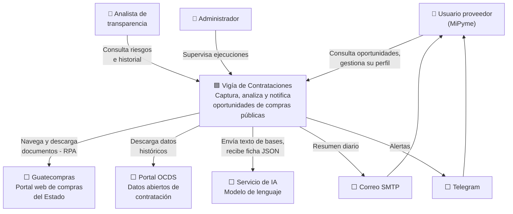
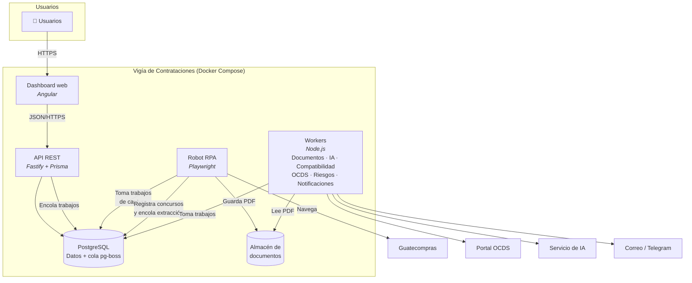
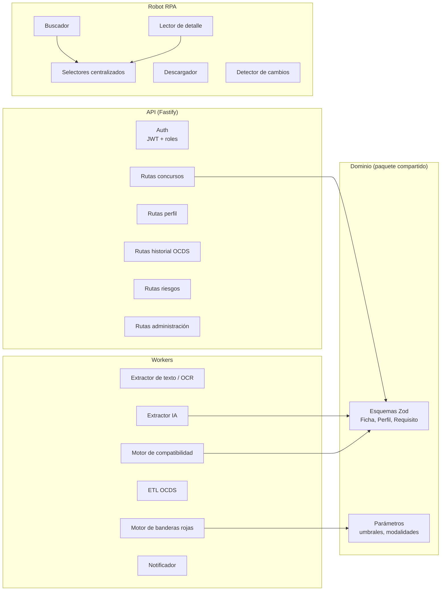
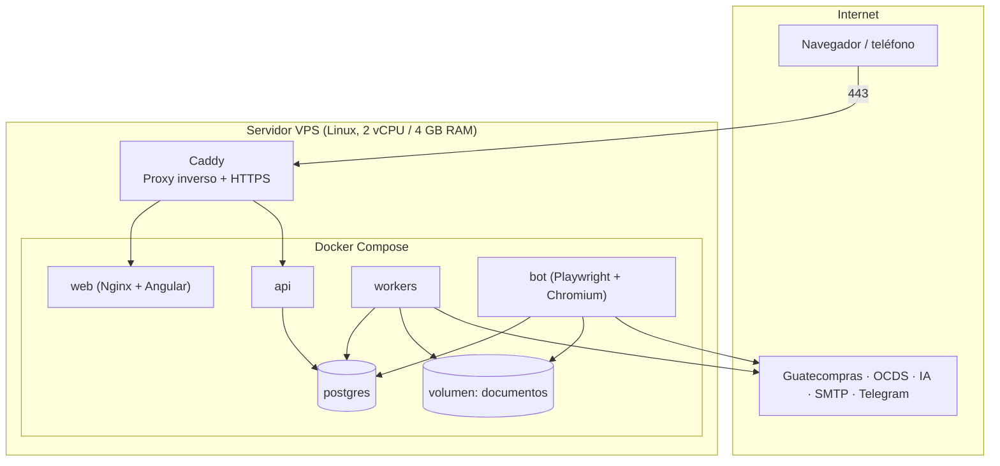

# 05 · Arquitectura y stack

## 5.1 Stack tecnológico

| Capa | Tecnología | Por qué |
|---|---|---|
| **Robot RPA** | **Playwright** + TypeScript | Automatización de navegador madura, espera automática de elementos, capturas y trazas para depuración, ejecución sin interfaz (headless). Ver [ADR-0002](adr/0002-plataforma-rpa.md). |
| Alternativa RPA | UiPath Community / Power Automate Desktop | Si el curso exige una plataforma RPA comercial. La arquitectura permite cambiar solo esta capa. |
| **Backend / API** | Node.js + **Fastify** + TypeScript | Rendimiento, validación de esquemas integrada, mismo lenguaje que el robot. |
| **ORM** | **Prisma** | Migraciones versionadas, tipado de extremo a extremo. |
| **Base de datos** | **PostgreSQL 16** | Gratuita, soporte JSONB para documentos OCDS, búsqueda de texto completo y extensión `pgvector` para similitud semántica. Ver [ADR-0003](adr/0003-base-de-datos.md). |
| **Cola de trabajos** | **pg-boss** | Cola sobre PostgreSQL: reintentos, programación y concurrencia sin agregar Redis. |
| **Planificador** | pg-boss (cron) | Ejecuciones programadas persistentes. |
| **Extracción de texto** | pdf.js (`pdfjs-dist`) | Texto de PDF digitales. |
| **OCR** | Tesseract (`tesseract.js` o binario) con idioma español | PDF escaneados. |
| **IA** | API de un LLM con salida estructurada (JSON) | Extracción de fichas y resúmenes. Ver [09 · IA](09-ia-extraccion.md). |
| **Validación** | **Zod** | Esquema único compartido entre IA, API y frontend. |
| **Almacenamiento de documentos** | Sistema de archivos local → S3/MinIO compatible | Simple en el piloto, migrable. |
| **Notificaciones** | Nodemailer (SMTP) + **Bot de Telegram** | Gratuitos y fáciles de integrar. WhatsApp queda fuera por costo y aprobación. |
| **Frontend** | **Angular** + Angular Material | Framework completo, tipado, componentes listos para tablas y formularios. |
| **Gráficas** | ECharts | Tablero de banderas rojas e historial de precios. |
| **Contenedores** | Docker + Docker Compose | Despliegue reproducible (RNF-12). |
| **Control de versiones** | Git + GitHub | Repositorio único (monorepo). |
| **CI** | GitHub Actions | Lint, pruebas y build en cada push. |
| **Pruebas** | Vitest (unitarias), Playwright Test (end-to-end) | |

## 5.2 Diagrama de contexto (C4 nivel 1)



## 5.3 Diagrama de contenedores (C4 nivel 2)



**Decisión clave:** el robot **no llama a la IA ni envía notificaciones**. Solo captura y encola. Esto lo mantiene simple y reemplazable (por ejemplo, por UiPath) sin tocar el resto del sistema.

## 5.4 Componentes del backend (C4 nivel 3)



## 5.5 Estructura del monorepo

```
vigia-contrataciones/
├── bot/
│   └── src/
│       ├── selectors.ts        # Todos los selectores del portal (RNF-07)
│       ├── flows/              # buscar, leerDetalle, descargar, detectarCambios
│       ├── runner.ts           # Toma trabajos de la cola
│       └── evidence.ts         # Capturas y HTML ante fallos
├── api/
│   ├── prisma/schema.prisma
│   └── src/
│       ├── routes/
│       ├── workers/            # documentos, ia, compatibilidad, ocds, riesgos, notificaciones
│       ├── domain/             # esquemas Zod y reglas
│       └── server.ts
├── web/                        # Angular
├── database/
│   ├── ocds/                   # scripts de carga
│   └── sql/riesgos/            # consultas de indicadores
├── infra/
│   ├── docker-compose.yml
│   └── .env.example
└── docs/
```

## 5.6 Diagrama de despliegue



**Entornos:**

| Entorno | Uso | Infraestructura |
|---|---|---|
| Desarrollo | Programación local | Docker Compose en la computadora del desarrollador |
| Piloto | Uso real con la empresa | VPS económico o servidor propio |

## 5.7 Seguridad

| Aspecto | Medida |
|---|---|
| Autenticación | Correo + contraseña con hash argon2; JWT de corta duración |
| Autorización | Roles: `PROVEEDOR`, `ANALISTA`, `ADMIN`; cada usuario solo ve sus perfiles |
| Secretos | Variables de entorno; `.env` excluido del repositorio; `.env.example` versionado |
| Transporte | HTTPS obligatorio (Caddy con certificados automáticos) |
| Datos de la empresa | Acceso restringido por perfil; anonimización para el informe |
| Robot | Sin credenciales de Guatecompras; solo información pública |
| Dependencias | `npm audit` y Dependabot en GitHub |
