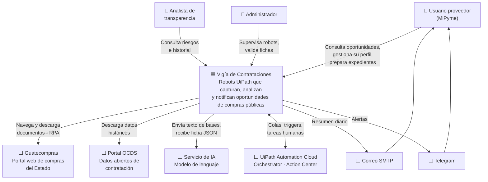
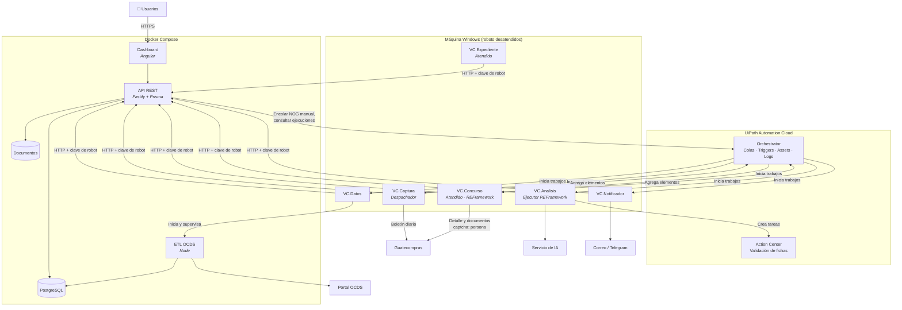
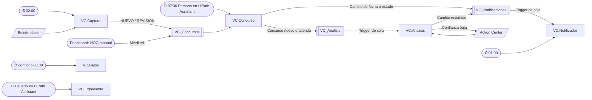
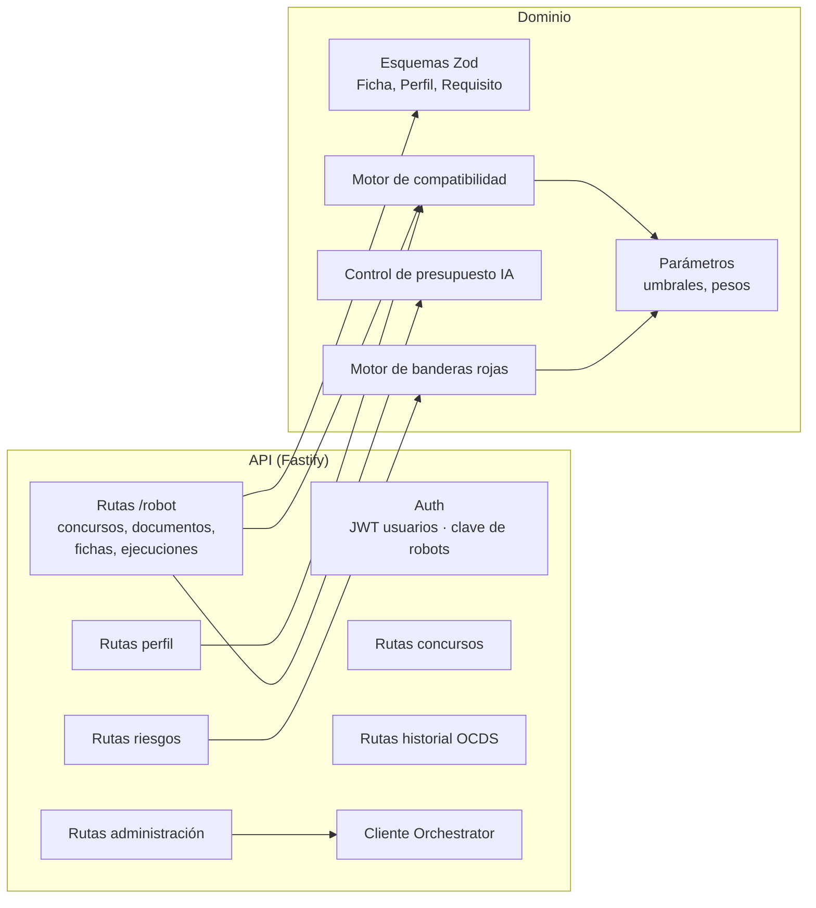
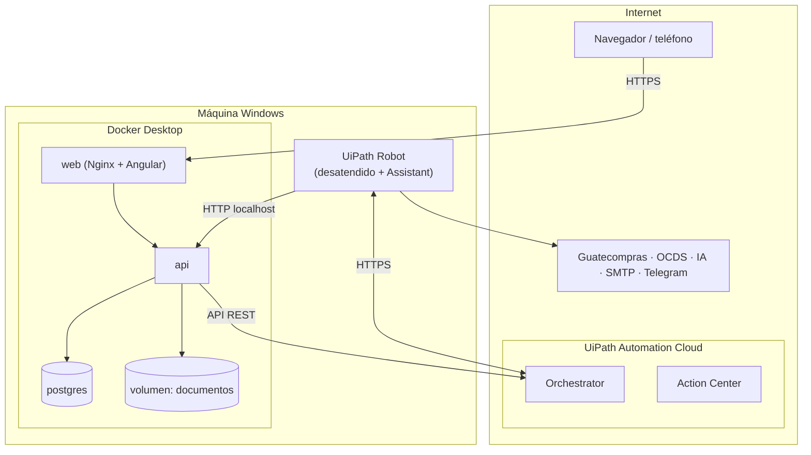

# 05 · Arquitectura y stack

La automatización con **UiPath** es el centro del sistema. Los robots ejecutan el proceso de negocio de principio a fin: capturan, analizan, notifican y preparan expedientes. La API y el dashboard dan soporte con datos, reglas de dominio y la interfaz de usuario. Ver [ADR-0004](adr/0004-uipath-como-centro.md).

## 5.1 Stack tecnológico

| Capa | Tecnología | Por qué |
|---|---|---|
| **Robots RPA** | **UiPath Studio 2026** (proyectos Windows, VB) con REFramework | Plataforma exigida por el curso. Flujos XAML para el proceso y coded workflows en C# para transformaciones. |
| **Orquestación** | **UiPath Orchestrator** (Automation Cloud) | Colas, triggers de tiempo y de cola, assets y credenciales, logs, alertas. Único planificador del sistema. |
| **Validación humana** | **UiPath Action Center** | Revisión de fichas con baja confianza (*human in the loop*). Alternativa: pantalla de revisión en el dashboard. |
| **Selectores** | **Object Repository** en la biblioteca `VC.Comun` | Un solo lugar para los elementos del portal (RNF-07). |
| **Texto y OCR** | Actividades PDF de UiPath (`Read PDF Text`, `Read PDF With OCR`) | Nativas, con motor OCR configurable. |
| **IA** | **Claude** (`claude-opus-5-5`) con salida estructurada, desde `VC.Analisis` con el SDK de C# | Extracción de fichas y resúmenes. Ver [09 · IA](09-ia-extraccion.md) y [ADR-0005](adr/0005-ia-claude.md). |
| **Notificaciones** | Actividades de correo SMTP de UiPath + API de bots de Telegram (HTTP) | Las envía el robot `VC.Notificador`. |
| **Backend / API** | Node.js + **Fastify** + TypeScript | Datos y reglas de dominio para robots y dashboard. |
| **ORM** | **Prisma** | Migraciones versionadas, tipado de extremo a extremo. |
| **Base de datos** | **PostgreSQL 16** + `pgvector` | JSONB para OCDS y fichas, texto completo en español, similitud semántica. Ver [ADR-0003](adr/0003-base-de-datos.md). |
| **Validación** | **Zod** | Esquema único de la ficha, del perfil y de las solicitudes de los robots. |
| **ETL OCDS** | Node.js (script en `database/ocds`) | Carga masiva de datos abiertos; no es una tarea de RPA ([ADR-0001](adr/0001-rpa-y-datos-abiertos.md)). La dispara `VC.Datos`. |
| **Almacenamiento de documentos** | Sistema de archivos local administrado por la API | Los robots suben y descargan archivos por la API. |
| **Frontend** | **Angular** (standalone, señales) + Angular Material (avisos) | Dashboard de oportunidades, fichas, perfil, historial y riesgos. Diseño en `web/DESIGN.md`. |
| **Contenedores** | Docker + Docker Compose | API, web y base de datos (RNF-12). |
| **Control de versiones** | Git + GitHub | Monorepo, incluidos los proyectos UiPath. |
| **Pruebas** | UiPath Test Suite (casos de prueba en Studio), Vitest, Playwright Test (solo dashboard) | Ver [13 · Pruebas](13-plan-de-pruebas.md). |

## 5.2 Diagrama de contexto (C4 nivel 1)



## 5.3 Diagrama de contenedores (C4 nivel 2)



**Decisiones clave:**

- **Cada proceso UiPath tiene una sola responsabilidad.** Solo `VC.Captura` (boletín, desatendido) y `VC.Concurso` (detalle, atendido) acceden a Guatecompras. El captcha del portal nunca se evade ([ADR-0006](adr/0006-boletin-y-robot-atendido.md)).
- **Los robots no tocan la base de datos.** Todo pasa por la API, que valida con Zod y aplica las reglas de dominio.
- **Las colas de Orchestrator conectan los procesos.** Si un robot falla, sus elementos quedan en la cola con su estado y se reintentan según la configuración de la cola.

## 5.4 Procesos, colas y triggers



| Cola | Elemento | Referencia | Reintentos automáticos |
|---|---|---|---|
| `VC_Concursos` | Un NOG por capturar o revisar: `Nog`, `Tipo` (`NUEVO`, `REVISION`, `MANUAL`) | `{Tipo}-{Nog}-{yyyyMMdd}` | 2 |
| `VC_Analisis` | Un concurso por analizar: `ConcursoId`, `Nog`, `Motivo` (`NUEVO`, `ADENDA`) | `{Nog}-{Motivo}-{DocumentoId}` | 1 |
| `VC_Notificaciones` | Un aviso inmediato: `ConcursoId`, `Tipo` (`CAMBIO`, `FICHA`) | `{Nog}-{Tipo}-{Id}` | 3 |

| Proceso | Trigger | Licencia |
|---|---|---|
| `VC.Captura` | Tiempo, diario 02:00 | Desatendido |
| `VC.Concurso` | Disparador cada hora de 07:00 a 21:00 (robot desatendido en la sesión abierta) o manual desde Assistant; procesa `VC_Concursos` | Desatendido con interfaz ([ADR-0008](adr/0008-automatizar-pasos-atendidos.md)) |
| `VC.Analisis` | Cola `VC_Analisis` | Desatendido |
| `VC.Notificador` | Tiempo, diario 07:00 (resumen preliminar) y cola `VC_Notificaciones` (cambios y fichas listas) | Desatendido |
| `VC.Datos` | Tiempo, semanal | Desatendido |
| `VC.Expediente` | La API lo inicia al marcar **Participaré**; también manual desde Assistant | Desatendido o atendido |

> La licencia actual (Community) permite **1 robot desatendido** a la vez: Orchestrator encola los trabajos y los ejecuta de a uno; desde ADR-0008 también `VC.Concurso` y `VC.Expediente` lo usan. Secuencia diaria: boletín hacia la 01:15 → `VC.Captura` (06:00) → resumen preliminar a las 07:00 → `VC.Concurso` cada hora → `VC.Analisis` por cola → cada ficha lista se notifica al terminar. La API consulta Orchestrator (External Application) para la bitácora de ejecuciones, el NOG manual y el inicio de `VC.Expediente`.

## 5.5 Componentes de la API (C4 nivel 3)



Cuando `VC.Analisis` registra una ficha válida, la API calcula la compatibilidad con cada perfil y los faltantes en la misma solicitud. Cuando un usuario cambia su perfil, la API recalcula la compatibilidad de los concursos abiertos sin intervención del robot.

## 5.6 Estructura del monorepo

```
vigia-contrataciones/
├── rpa/                         # Proyectos UiPath (ver 08 · Diseño de los robots)
│   ├── VC.Comun/                # Biblioteca: Object Repository, cliente API, utilidades
│   ├── VC.Captura/              # Despachador: boletín diario
│   ├── VC.Concurso/             # Ejecutor atendido REFramework
│   ├── VC.Analisis/             # Ejecutor REFramework + Action Center
│   ├── VC.Notificador/
│   ├── VC.Datos/
│   ├── VC.Expediente/           # Atendido
│   └── fixtures/                # HTML guardado del portal para pruebas
├── api/
│   ├── prisma/schema.prisma
│   └── src/
│       ├── routes/              # incluye routes/robot/*
│       ├── domain/              # esquemas Zod, compatibilidad, riesgos
│       ├── orchestrator/        # cliente de la API de Orchestrator
│       └── server.ts
├── web/                         # Angular
├── database/
│   ├── ocds/                    # ETL de datos abiertos
│   └── sql/riesgos/             # consultas de indicadores
├── infra/
│   ├── docker-compose.yml
│   └── .env.example
└── docs/
```

## 5.7 Diagrama de despliegue



**Entornos:**

| Entorno | Uso | Infraestructura |
|---|---|---|
| Desarrollo | Programación y pruebas | Computadora del autor: Studio, robot y Docker Desktop |
| Piloto | Uso real con la empresa | Máquina Windows con el robot y Docker, o robot en Windows y API/BD en un VPS (el robot llama a la API por HTTPS). Se decide en la fase 6 según R-13. |

## 5.8 Seguridad

| Aspecto | Medida |
|---|---|
| Autenticación de usuarios | Correo + contraseña con hash argon2; JWT de corta duración |
| Autenticación de robots | Clave de robot por proceso, guardada como *credential asset* en Orchestrator; rutas `/robot/*` solo aceptan esa clave |
| Acceso a Orchestrator | External Application con credenciales de cliente y scopes mínimos; secreto solo en `infra/.env` |
| Autorización | Roles: `PROVEEDOR`, `ANALISTA`, `ADMIN`; cada usuario solo ve sus perfiles |
| Secretos | Variables de entorno (`.env` excluido del repositorio) y assets de Orchestrator; nunca en `Config.json` ni en el código de los robots |
| Transporte | HTTPS fuera de la máquina local |
| Datos de la empresa | Acceso restringido por perfil; anonimización para el informe |
| Robots | Sin credenciales de Guatecompras; solo información pública |
| Dependencias | `npm audit` y Dependabot; paquetes de UiPath con versiones fijas en `project.json` |
