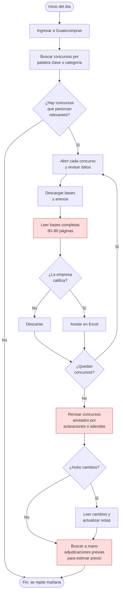
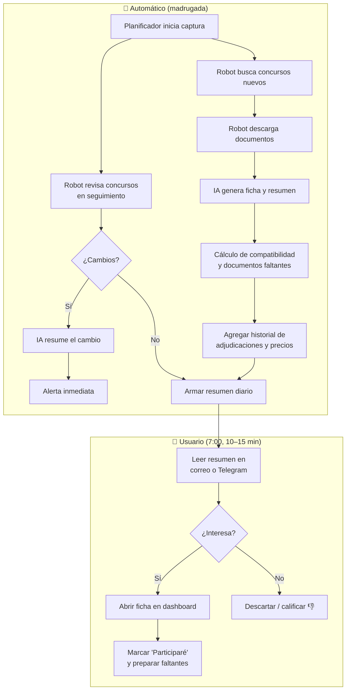
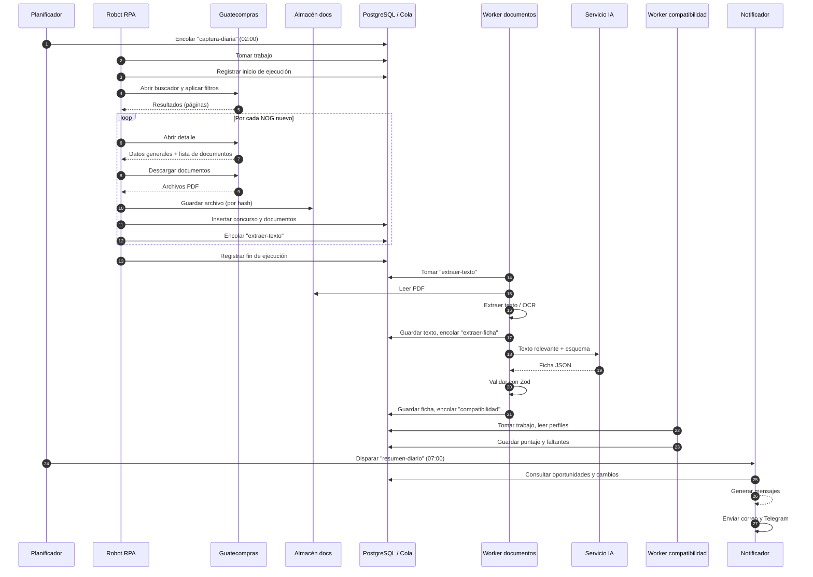
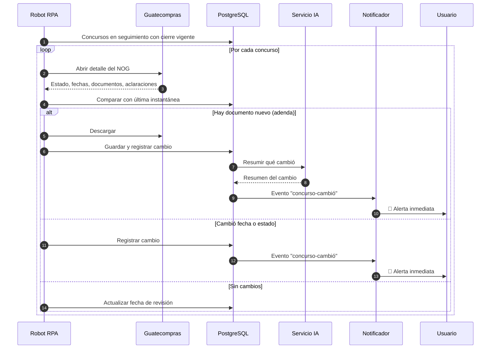
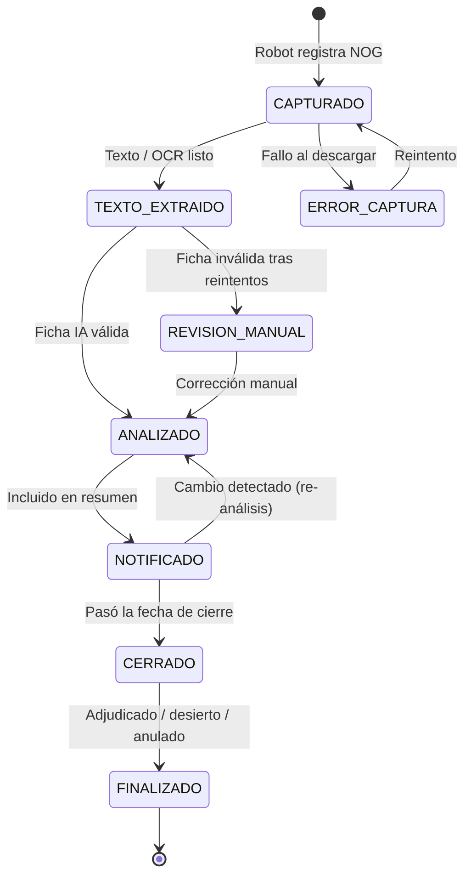
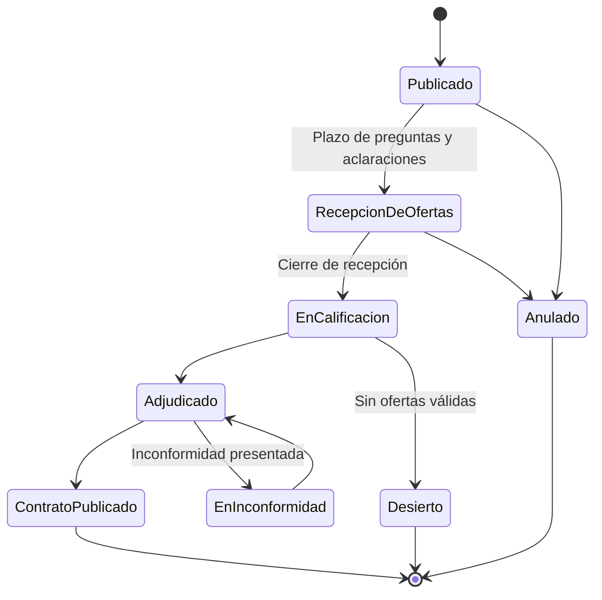
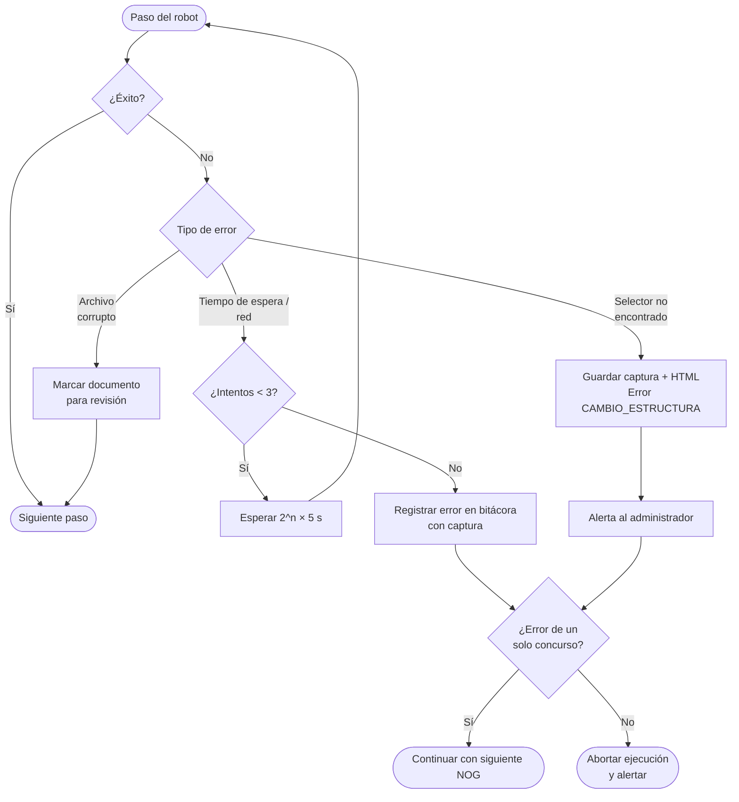
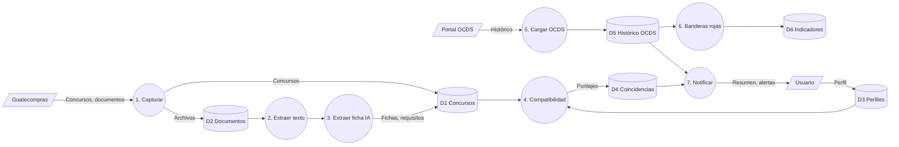

# 06 · Diagramas de procesos

## 6.1 Proceso actual (AS-IS)

En rojo, los pasos que más tiempo consumen y donde más errores ocurren.

## 6.2 Proceso propuesto (TO-BE)

## 6.3 Comparación AS-IS vs TO-BE

| Actividad | AS-IS | TO-BE |
|---|---|---|
| Buscar concursos | Manual, diario | Robot |
| Descargar documentos | Manual | Robot |
| Leer bases | Manual, 30–90 min por concurso | IA; el usuario lee un resumen de 3–5 líneas |
| Determinar si califica | Criterio del encargado | Puntaje de compatibilidad + faltantes |
| Seguimiento de adendas | Manual, a veces se omite | Robot + alerta inmediata |
| Referencia de precios | Rara vez se hace | Automática con datos OCDS |
| **Tiempo diario** | **60–120 min** (a validar) | **10–15 min** (meta) |

## 6.4 Diagrama de secuencia · Captura diaria

## 6.5 Diagrama de secuencia · Detección de cambios

## 6.6 Diagrama de estados · Concurso (en el sistema)

## 6.7 Diagrama de estados · Concurso (en Guatecompras)

Referencia del ciclo de vida real que el robot debe reconocer:

_Los nombres exactos de estados se confirmarán al levantar la estructura del portal en la fase 3._

## 6.8 Diagrama de actividad · Manejo de errores del robot

## 6.9 Flujo de datos (DFD nivel 1)

