# 07 · Modelo de datos

El modelo se divide en cuatro dominios: **operación** (lo que captura el robot), **análisis** (lo que produce la IA), **empresa** (usuarios y perfiles) e **histórico** (datos OCDS y riesgos).

## 7.1 Diagrama entidad-relación

```mermaid
erDiagram
    ENTIDAD ||--o{ CONCURSO : publica
    CONCURSO ||--o{ DOCUMENTO : tiene
    CONCURSO ||--o{ CAMBIO_CONCURSO : registra
    CONCURSO ||--o| FICHA : "se resume en"
    FICHA ||--o{ REQUISITO : contiene
    FICHA ||--o{ CRITERIO_CALIFICACION : contiene
    CONCURSO ||--o{ COINCIDENCIA : genera
    PERFIL_EMPRESA ||--o{ COINCIDENCIA : recibe
    PERFIL_EMPRESA ||--o{ DOCUMENTO_EMPRESA : dispone
    PERFIL_EMPRESA ||--o{ SEGUIMIENTO : marca
    CONCURSO ||--o{ SEGUIMIENTO : "es seguido en"
    USUARIO }o--o{ PERFIL_EMPRESA : administra
    PERFIL_EMPRESA ||--o{ NOTIFICACION : recibe
    PERFIL_EMPRESA ||--o{ EXPEDIENTE : prepara
    CONCURSO ||--o{ EXPEDIENTE : "se prepara en"
    EJECUCION_ROBOT ||--o{ ERROR_ROBOT : registra
    EJECUCION_ROBOT ||--o{ CONCURSO : captura

    OCDS_PROCESO ||--o{ OCDS_ADJUDICACION : tiene
    OCDS_ADJUDICACION }o--|| PROVEEDOR : "adjudicada a"
    OCDS_PROCESO }o--|| ENTIDAD : "convocado por"
    OCDS_PROCESO ||--o{ INDICADOR_RIESGO : activa

    ENTIDAD {
        int id PK
        string codigo_gc "código en Guatecompras"
        string nombre
        string tipo "ministerio, municipalidad, autónoma..."
        string departamento
    }
    CONCURSO {
        int id PK
        string nog UK
        int entidad_id FK
        string titulo
        string unidad_compradora
        string modalidad
        string[] categorias "del boletín diario"
        jsonb origen_boletin "fila original del boletín"
        decimal monto_estimado
        datetime fecha_publicacion
        datetime fecha_cierre
        string estado_gc "estado en Guatecompras"
        string estado_sistema "PRESELECCIONADO, CAPTURADO, ANALIZADO..."
        string url
        jsonb instantanea "último detalle leído por VC.Concurso"
        int ejecucion_id FK
        datetime creado_en
        datetime revisado_en
    }
    DOCUMENTO {
        int id PK
        int concurso_id FK
        string nombre_original
        string tipo "bases, anexo, adenda, aclaracion"
        string sha256
        string ruta_almacen
        int tamano_bytes
        int paginas
        boolean requiere_ocr
        text texto_extraido
        datetime publicado_en
    }
    CAMBIO_CONCURSO {
        int id PK
        int concurso_id FK
        string tipo "DOCUMENTO, FECHA, ESTADO, ACLARACION"
        jsonb antes
        jsonb despues
        text resumen_ia
        datetime detectado_en
    }
    FICHA {
        int id PK
        int concurso_id FK
        text resumen
        string objeto
        decimal monto
        string plazo_entrega
        string lugar_entrega
        datetime fecha_limite_ofertas
        jsonb garantias
        jsonb datos_completos "JSON validado"
        decimal confianza "0-1, calculada por la API"
        string validada_por "IA, HUMANO"
        string tarea_action_center
        string modelo_ia
        int tokens_entrada
        int tokens_salida
        decimal costo_usd
        datetime generado_en
    }
    REQUISITO {
        int id PK
        int ficha_id FK
        string tipo "legal, tecnico, financiero, experiencia"
        string descripcion
        string documento_normalizado "RTU, RGAE, fianza..."
        boolean obligatorio
        string referencia "página o sección"
        boolean posible_restrictivo
    }
    CRITERIO_CALIFICACION {
        int id PK
        int ficha_id FK
        string criterio
        decimal ponderacion
    }
    USUARIO {
        int id PK
        string correo UK
        string hash_contrasena
        string nombre
        string rol "PROVEEDOR, ANALISTA, ADMIN"
        string telegram_chat_id
        boolean activo
    }
    PERFIL_EMPRESA {
        int id PK
        string nombre
        string nit
        boolean activo
        string[] categorias
        string[] palabras_clave
        string[] modalidades "prefijos aceptados; vacío = todas"
        string[] departamentos
        decimal monto_min
        decimal monto_max
        int umbral_compatibilidad
        vector embedding "pgvector"
        string hora_resumen
        string[] canales
    }
    DOCUMENTO_EMPRESA {
        int id PK
        int perfil_id FK
        string documento_normalizado
        date vence_en
    }
    COINCIDENCIA {
        int id PK
        int concurso_id FK
        int perfil_id FK
        string etapa "PRELIMINAR (boletín), COMPLETA (ficha IA)"
        int puntaje
        jsonb detalle "componentes del puntaje"
        string[] faltantes
        boolean notificado
        string calificacion_usuario "relevante, no_relevante"
    }
    SEGUIMIENTO {
        int id PK
        int perfil_id FK
        int concurso_id FK
        string estado "siguiendo, participare, descartado"
        datetime actualizado_en
    }
    NOTIFICACION {
        int id PK
        int perfil_id FK
        string tipo "resumen, cambio, recordatorio"
        string canal "correo, telegram"
        string estado "enviado, fallido"
        jsonb contenido
        datetime enviado_en
    }
    EXPEDIENTE {
        int id PK
        int perfil_id FK
        int concurso_id FK
        string ruta "carpeta generada"
        string[] faltantes
        int duracion_seg
        datetime generado_en
    }
    EJECUCION_ROBOT {
        int id PK
        string proceso "VC.Captura, VC.Concurso..."
        string job_key "clave del trabajo en Orchestrator"
        string estado "EN_CURSO, EXITOSA, PARCIAL, FALLIDA"
        datetime inicio
        datetime fin
        int elementos_exitosos
        int excepciones_negocio
        int excepciones_sistema
        int concursos_nuevos
        int documentos_descargados
    }
    ERROR_ROBOT {
        int id PK
        int ejecucion_id FK
        string nog
        string queue_item_id "elemento de la cola"
        string tipo "SISTEMA, NEGOCIO"
        string categoria "RED, CAMBIO_ESTRUCTURA, ARCHIVO, PORTAL_CAIDO, OTRO"
        text mensaje
        string ruta_captura
        string ruta_html
        datetime ocurrido_en
    }
    OCDS_PROCESO {
        int id PK
        string ocid UK
        string nog
        int entidad_id FK
        string titulo
        string modalidad
        string[] categorias "del boletín diario"
        jsonb origen_boletin "fila original del boletín"
        decimal monto_estimado
        datetime fecha_publicacion
        datetime fecha_cierre
        int numero_ofertas
        string estado
        jsonb raw
    }
    OCDS_ADJUDICACION {
        int id PK
        int proceso_id FK
        int proveedor_id FK
        decimal monto
        datetime fecha
    }
    PROVEEDOR {
        int id PK
        string nit UK
        string nombre
        date fecha_inscripcion_rgae
    }
    INDICADOR_RIESGO {
        int id PK
        int proceso_id FK
        string codigo "IR-01..."
        decimal valor
        text evidencia
        datetime calculado_en
    }
```

## 7.2 Diccionario de datos (tablas principales)

### CONCURSO

| Campo | Tipo | Nulo | Descripción |
|---|---|---|---|
| id | serial | No | Identificador interno |
| nog | varchar(20) | No | Número de Operación Guatecompras. Único (RN-01). |
| entidad_id | int | No | Entidad convocante |
| titulo | text | No | Descripción del concurso según Guatecompras |
| unidad_compradora | varchar(255) | Sí | Unidad ejecutora dentro de la entidad |
| modalidad | varchar(60) | No | Compra directa, cotización, licitación u otra |
| categoria | varchar(120) | Sí | Categoría de Guatecompras |
| monto_estimado | numeric(14,2) | Sí | Monto, si se publica |
| fecha_publicacion | timestamptz | No | |
| fecha_cierre | timestamptz | Sí | Fecha límite de ofertas |
| estado_gc | varchar(60) | No | Estado según Guatecompras |
| estado_sistema | enum | No | `PRESELECCIONADO`, `CAPTURADO`, `TEXTO_EXTRAIDO`, `ANALIZADO`, `REVISION_MANUAL`, `NOTIFICADO`, `CERRADO`, `FINALIZADO`, `ERROR_CAPTURA` |
| url | text | No | Enlace al concurso |
| instantanea | jsonb | No | Último estado visto, usado para detectar cambios |

### DOCUMENTO

| Campo | Tipo | Nulo | Descripción |
|---|---|---|---|
| sha256 | char(64) | No | Hash del archivo; único por concurso (RN-02) |
| tipo | enum | No | `BASES`, `ESPECIFICACIONES`, `ANEXO`, `ADENDA`, `ACLARACION`, `OTRO` |
| requiere_ocr | boolean | No | Verdadero si el PDF no tiene texto digital |
| texto_extraido | text | Sí | Texto completo (índice de texto completo en español) |

### FICHA

| Campo | Tipo | Nulo | Descripción |
|---|---|---|---|
| datos_completos | jsonb | No | Respuesta de la IA validada contra el esquema (ver [09](09-ia-extraccion.md)) |
| tokens_entrada / salida | int | No | Para control de costos (RNF-11) |
| costo_usd | numeric(8,5) | No | Costo calculado de la llamada |
| confianza | numeric(3,2) | No | Calculada con verificaciones objetivas (ver [09](09-ia-extraccion.md#confianza-de-la-ficha)); bajo el umbral, `VC.Analisis` envía la ficha a Action Center |
| validada_por | enum | No | `IA` o `HUMANO` (corregida en Action Center o en el dashboard) |

### EJECUCION_ROBOT y ERROR_ROBOT

Orchestrator conserva sus propios logs y el historial de las colas. Estas tablas guardan un **resumen propio** para el dashboard (CU-12) y para las métricas del informe, sin depender de la retención de la licencia. `job_key` y `queue_item_id` enlazan cada registro con Orchestrator.

| Campo | Descripción |
|---|---|
| tipo | `SISTEMA` = System Exception (se reintenta); `NEGOCIO` = Business Rule Exception (no se reintenta) |
| categoria | Clasificación para el análisis de fallos (ver [08 · Diseño de los robots](08-diseno-del-bot.md#87-manejo-de-excepciones)) |

### Telegram (RF-NOT-02)

`PERFIL_EMPRESA.telegram_chats` guarda los chats vinculados al perfil; reciben los avisos del perfil además del correo. `VINCULO_TELEGRAM` (código, perfil, vence_en) guarda los códigos de un solo uso del enlace de vinculación. Se vincula por perfil, no por usuario, porque los avisos son de la empresa.

### EXPEDIENTE

Registra cada expediente de oferta armado por `VC.Expediente`. `duracion_seg` alimenta la métrica de tiempo de preparación frente al proceso manual.

### COINCIDENCIA

| Campo | Tipo | Nulo | Descripción |
|---|---|---|---|
| puntaje | smallint | No | 0–100 |
| detalle | jsonb | No | Ej.: `{"categoria":30,"palabras":22,"departamento":10,"monto":15,"requisitos":15}` |
| faltantes | text[] | No | Documentos normalizados que la empresa no tiene vigentes |
| calificacion_usuario | enum | Sí | Retroalimentación para la métrica de precisión |

**Etapas de COINCIDENCIA:** `PRELIMINAR` se calcula con los datos del boletín (categoría, palabras clave, modalidad) para decidir qué concursos captura el robot atendido; `COMPLETA` se calcula con la ficha de la IA (monto, departamento, requisitos). Única por `(concurso_id, perfil_id, etapa)`.

### Catálogo de documentos normalizados

La IA mapea cada requisito documental a un código común para poder compararlo con el perfil:

| Código | Documento |
|---|---|
| `RTU` | Registro Tributario Unificado actualizado |
| `RGAE` | Constancia de inscripción y precalificación en el RGAE |
| `PATENTE_EMPRESA` | Patente de comercio de empresa |
| `PATENTE_SOCIEDAD` | Patente de comercio de sociedad |
| `SOLVENCIA_FISCAL` | Solvencia fiscal |
| `DPI_REPRESENTANTE` | DPI del representante legal |
| `NOMBRAMIENTO` | Nombramiento del representante legal |
| `FIANZA_SOSTENIMIENTO` | Seguro de caución de sostenimiento de oferta |
| `FIANZA_CUMPLIMIENTO` | Seguro de caución de cumplimiento |
| `DECLARACION_JURADA` | Declaración jurada (Art. 26 y 80 de la Ley) |
| `CARTA_DISTRIBUIDOR` | Carta de distribuidor autorizado |
| `REGISTRO_SANITARIO` | Registro sanitario |
| `EXPERIENCIA` | Constancias o cartas de experiencia |
| `ESTADOS_FINANCIEROS` | Estados financieros |
| `OTRO` | Requisito no catalogado (se muestra textual) |

_El catálogo se ajustará con los requisitos reales encontrados en las bases durante la fase 4._

## 7.3 Índices relevantes

| Tabla | Índice | Uso |
|---|---|---|
| concurso | `UNIQUE (nog)` | Evitar duplicados |
| concurso | `(estado_sistema, fecha_cierre)` | Seguimiento y resumen diario |
| documento | `UNIQUE (concurso_id, sha256)` | RN-02 |
| documento | GIN `to_tsvector('spanish', texto_extraido)` | Búsqueda de texto completo |
| coincidencia | `(perfil_id, notificado, puntaje DESC)` | Armado del resumen |
| ocds_proceso | `(entidad_id, fecha_publicacion)` | Historial y riesgos |
| ocds_adjudicacion | `(proveedor_id, fecha)` | Perfil de proveedor |
| perfil_empresa | ivfflat/hnsw sobre `embedding` | Similitud semántica |
