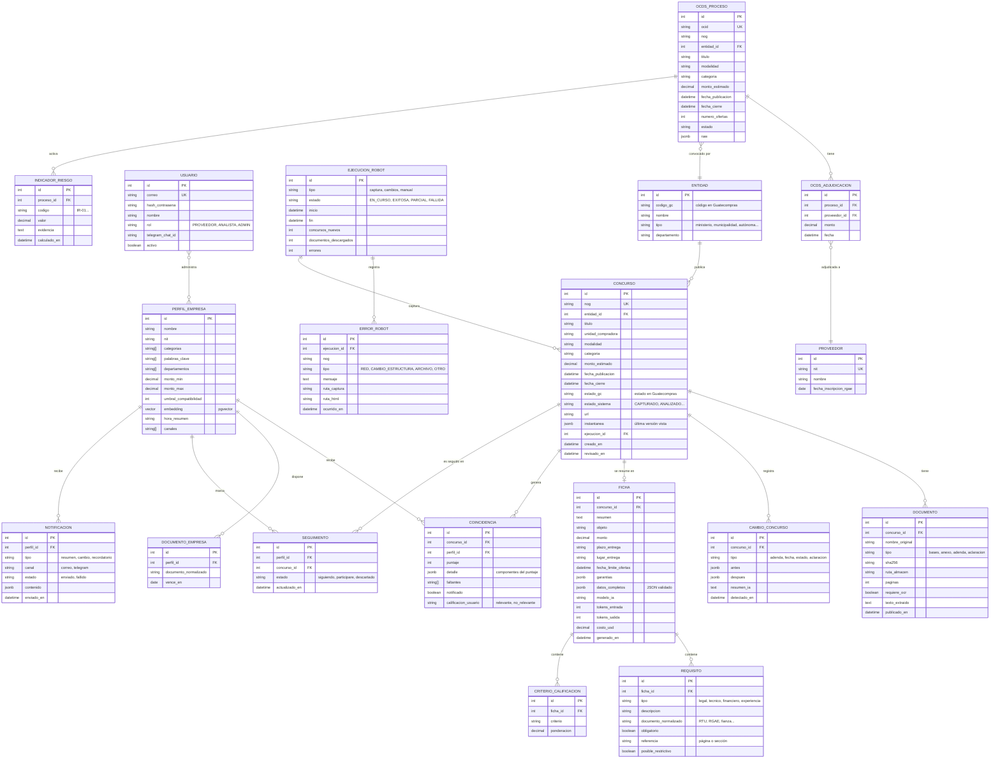

# 07 · Modelo de datos

El modelo se divide en cuatro dominios: **operación** (lo que captura el robot), **análisis** (lo que produce la IA), **empresa** (usuarios y perfiles) e **histórico** (datos OCDS y riesgos).

## 7.1 Diagrama entidad-relación

## 7.2 Diccionario de datos (tablas principales)

### CONCURSO

| Campo | Tipo | Nulo | Descripción |
|---|---|---|---|
| id | serial | No | Identificador interno |
| nog | varchar(20) | No | Número de Operación Guatecompras. Único (RN-01). |
| entidad_id | int | No | Entidad convocante |
| titulo | text | No | Descripción del concurso según Guatecompras |
| unidad_compradora | varchar(255) | Sí | Unidad ejecutora dentro de la entidad |
| modalidad | varchar(60) | No | Compra directa, cotización, licitación u otra |
| categoria | varchar(120) | Sí | Categoría de Guatecompras |
| monto_estimado | numeric(14,2) | Sí | Monto, si se publica |
| fecha_publicacion | timestamptz | No | |
| fecha_cierre | timestamptz | Sí | Fecha límite de ofertas |
| estado_gc | varchar(60) | No | Estado según Guatecompras |
| estado_sistema | enum | No | `CAPTURADO`, `TEXTO_EXTRAIDO`, `ANALIZADO`, `REVISION_MANUAL`, `NOTIFICADO`, `CERRADO`, `FINALIZADO`, `ERROR_CAPTURA` |
| url | text | No | Enlace al concurso |
| instantanea | jsonb | No | Último estado visto, usado para detectar cambios |

### DOCUMENTO

| Campo | Tipo | Nulo | Descripción |
|---|---|---|---|
| sha256 | char(64) | No | Hash del archivo; único por concurso (RN-02) |
| tipo | enum | No | `BASES`, `ESPECIFICACIONES`, `ANEXO`, `ADENDA`, `ACLARACION`, `OTRO` |
| requiere_ocr | boolean | No | Verdadero si el PDF no tiene texto digital |
| texto_extraido | text | Sí | Texto completo (índice de texto completo en español) |

### FICHA

| Campo | Tipo | Nulo | Descripción |
|---|---|---|---|
| datos_completos | jsonb | No | Respuesta de la IA validada contra el esquema (ver [09](09-ia-extraccion.md)) |
| tokens_entrada / salida | int | No | Para control de costos (RNF-11) |
| costo_usd | numeric(8,5) | No | Costo calculado de la llamada |

### COINCIDENCIA

| Campo | Tipo | Nulo | Descripción |
|---|---|---|---|
| puntaje | smallint | No | 0–100 |
| detalle | jsonb | No | Ej.: `{"categoria":30,"palabras":22,"departamento":10,"monto":15,"requisitos":15}` |
| faltantes | text[] | No | Documentos normalizados que la empresa no tiene vigentes |
| calificacion_usuario | enum | Sí | Retroalimentación para la métrica de precisión |

### Catálogo de documentos normalizados

La IA mapea cada requisito documental a un código común para poder compararlo con el perfil:

| Código | Documento |
|---|---|
| `RTU` | Registro Tributario Unificado actualizado |
| `RGAE` | Constancia de inscripción y precalificación en el RGAE |
| `PATENTE_EMPRESA` | Patente de comercio de empresa |
| `PATENTE_SOCIEDAD` | Patente de comercio de sociedad |
| `SOLVENCIA_FISCAL` | Solvencia fiscal |
| `DPI_REPRESENTANTE` | DPI del representante legal |
| `NOMBRAMIENTO` | Nombramiento del representante legal |
| `FIANZA_SOSTENIMIENTO` | Seguro de caución de sostenimiento de oferta |
| `FIANZA_CUMPLIMIENTO` | Seguro de caución de cumplimiento |
| `DECLARACION_JURADA` | Declaración jurada (Art. 26 y 80 de la Ley) |
| `CARTA_DISTRIBUIDOR` | Carta de distribuidor autorizado |
| `REGISTRO_SANITARIO` | Registro sanitario |
| `EXPERIENCIA` | Constancias o cartas de experiencia |
| `ESTADOS_FINANCIEROS` | Estados financieros |
| `OTRO` | Requisito no catalogado (se muestra textual) |

_El catálogo se ajustará con los requisitos reales encontrados en las bases durante la fase 4._

## 7.3 Índices relevantes

| Tabla | Índice | Uso |
|---|---|---|
| concurso | `UNIQUE (nog)` | Evitar duplicados |
| concurso | `(estado_sistema, fecha_cierre)` | Seguimiento y resumen diario |
| documento | `UNIQUE (concurso_id, sha256)` | RN-02 |
| documento | GIN `to_tsvector('spanish', texto_extraido)` | Búsqueda de texto completo |
| coincidencia | `(perfil_id, notificado, puntaje DESC)` | Armado del resumen |
| ocds_proceso | `(entidad_id, fecha_publicacion)` | Historial y riesgos |
| ocds_adjudicacion | `(proveedor_id, fecha)` | Perfil de proveedor |
| perfil_empresa | ivfflat/hnsw sobre `embedding` | Similitud semántica |
