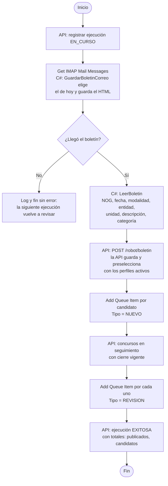
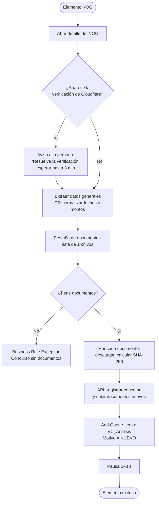
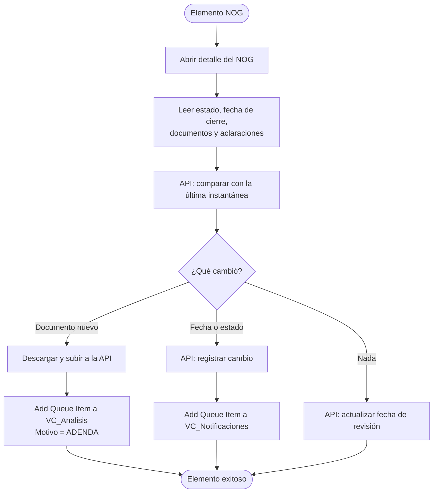
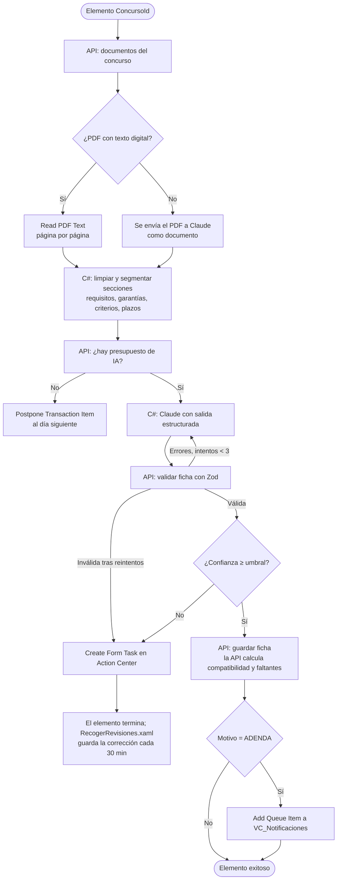

# 08 · Diseño de los robots UiPath

## 8.1 Principios

- **Un proceso, una responsabilidad.** Cada robot hace una parte del proceso de negocio y se comunica con los demás por colas de Orchestrator.
- **Patrón despachador / ejecutor.** El despachador decide *qué* trabajo hay; el ejecutor procesa un elemento a la vez con REFramework. Un fallo en un concurso no detiene a los demás (RNF-06).
- **Los robots no acceden a la base de datos.** Leen y escriben por la API (`/robot/*`).
- **Configuración fuera del código:** `Data/Config.json` para valores no sensibles y **assets** de Orchestrator para lo que cambia por entorno o es secreto.
- **Uso responsable del portal** (8.8). El boletín diario se lee de forma desatendida; el detalle de los concursos, que está protegido con captcha, lo abre un **robot atendido** en el navegador de una persona ([ADR-0006](adr/0006-boletin-y-robot-atendido.md)).

## 8.2 Proyectos

| Proyecto | Tipo de proyecto | Plantilla | Responsabilidad |
|---|---|---|---|
| `VC.Comun` | Biblioteca | — | Object Repository de Guatecompras, cliente de la API, pausa responsable, captura de evidencia, normalización de datos (C#) |
| `VC.Captura` | Proceso desatendido | Secuencia | Despachador: leer el boletín diario, preseleccionar con la API y agregar candidatos a `VC_Concursos` |
| `VC.Concurso` | Proceso con interfaz: robot **desatendido en la sesión abierta** cada hora, o atendido desde Assistant ([ADR-0008](adr/0008-automatizar-pasos-atendidos.md)) | REFramework | Ejecutor: abrir el detalle (la persona resuelve el captcha si aparece), descargar documentos, detectar cambios |
| `VC.Analisis` | Proceso de orquestación (permite esperar tareas de Action Center) | REFramework | Ejecutor: texto/OCR, ficha con IA, validación humana |
| `VC.Notificador` | Proceso | Secuencia | Resumen diario, alertas inmediatas, recordatorios, aviso de documentos por vencer |
| `VC.Datos` | Proceso | Secuencia | Disparar el ETL OCDS y el recálculo de banderas rojas; supervisar y reportar |
| `VC.Expediente` | Proceso atendido | Secuencia con formularios | Armar el expediente de oferta de un concurso |

Todos los proyectos usan compatibilidad **Windows** y lenguaje de expresiones **VB**. Las transformaciones complejas van en **coded workflows (C#)**; la lógica sin dependencias de UiPath (por ejemplo `BoletinParser`) se prueba con xUnit en `rpa/tests/`.

**Procesos en segundo plano:** `VC.Captura`, `VC.Analisis`, `VC.Notificador` y `VC.Datos` no usan interfaz gráfica, así que se publican con `requiresUserInteraction: false`. Corren sin sesión interactiva de Windows, lo que evita el problema de ejecución desatendida en Windows Home (R-13). Solo `VC.Concurso` y `VC.Expediente` necesitan interfaz, y ambos son atendidos.

## 8.3 `VC.Captura` · Despachador (desatendido)

| Disparador | Entrada | Salida |
|---|---|---|
| Tiempo, cada hora de 06:00 a 12:00 (Guatecompras no publica la hora de envío; se ajusta con los primeros boletines) | Correo del *Boletín diario de concursos* (suscripción de Guatecompras) | Candidatos en `VC_Concursos` |



El boletín es un HTML de ~2 MB con todos los concursos publicados el día anterior (~2 000); llega por correo y también se publica en `https://www.guatecompras.gt/BoletinDiario/BoletinDiarioDD-MM-AAAA.html`. El robot **no lo descarga del portal**: Cloudflare rechaza clientes que no son navegador y no se evade. El robot reconoce el correo por el remitente (dominio `guatecompras.gt`) y el asunto "Publicaciones de ayer ...", recibido hoy, y toma el HTML de un adjunto .html o del cuerpo (`BoletinCorreo.cs`, con pruebas). Para pruebas o carga manual, el argumento `in_RutaBoletin` acepta un archivo ya guardado. La preselección la hace la API con las mismas reglas de compatibilidad, usando solo los datos del boletín: categoría, palabras clave en la descripción, entidad, modalidad y fecha. Los concursos preseleccionados quedan en estado `PRESELECCIONADO`.

## 8.4 `VC.Concurso` · Ejecutor atendido (REFramework)

Lo inicia el encargado (o el administrador) desde **UiPath Assistant** al llegar en la mañana, o con un trigger de Assistant a las 07:30. Trabaja en el navegador normal de esa persona, mientras ella hace otras cosas.

| Estado REFramework | Qué hace |
|---|---|
| **Init** | Leer `Config.json` y assets; abrir el navegador una sola vez |
| **Get Transaction Data** | `Get Transaction Item` de `VC_Concursos` |
| **Process** | Según `Tipo`: captura completa (`NUEVO`, `MANUAL`) o revisión de cambios (`REVISION`) |
| **End** | Cerrar el navegador; API: cerrar ejecución con totales |

**Process · captura (`NUEVO`, `MANUAL`)**



**Process · revisión (`REVISION`)**



## 8.5 `VC.Analisis` · Ejecutor (REFramework + Action Center)



**Formulario de Action Center** (`VC.Analisis/Data/FormularioValidacion.json`), detalles comprobados el 30/10/2026:

- El archivo contiene **solo la lista de componentes** de form.io: `Create Form Task` la envuelve en `{"components": ...}`. Si se le pasa el formulario completo, Action Center falla con `(this.hook(...) || []).forEach is not a function`.
- Action Center **guarda el diseño en caché por `FormLayoutGuid`**: al modificar el formulario hay que cambiar ese GUID en `Framework/Process.xaml`, o las tareas nuevas seguirán usando el diseño anterior.
- `Get Form Tasks` devuelve la lista de tareas **sin los datos del formulario**: `RecogerRevisiones.xaml` lee cada tarea con `Get Task Data` antes de guardarla.
- No se usa el componente `htmlelement` (no se muestra) y las fechas van como `DD/MM/AAAA HH:MM`: Action Center convierte los textos ISO en fechas de JavaScript y les cambia la zona horaria. `ProcesarRevision.cs` las vuelve a ISO.

La validación humana cubre RN-06: la ficha no se descarta, la corrige una persona. El robot no se suspende esperando la tarea (el REFramework envuelve cada transacción en Try Catch, donde no se permite persistencia): un segundo punto de entrada, `RecogerRevisiones.xaml`, con trigger cada 30 minutos, recoge las tareas completadas con `Get Form Tasks` y guarda las fichas como validadas por una persona. Si la licencia no incluye Action Center, el concurso queda en `REVISION_MANUAL` y se corrige desde el dashboard.

## 8.6 `VC.Notificador`, `VC.Datos` y `VC.Expediente`

| Proceso | Modo | Pasos principales |
|---|---|---|
| `VC.Notificador` | Resumen (07:00, `in_Modo = RESUMEN`) | `GET /robot/notificaciones/resumen` (la API decide qué y a quién: usuarios activos del perfil) → C#: `PlantillaCorreo` arma el HTML → `Send SMTP Mail Message` (la credencial se lee junto al envío, ST-SEC-008) → `POST /robot/notificaciones` registra el envío y marca las oportunidades como notificadas. Un envío fallido se registra y no detiene a los demás. Telegram (RF-NOT-02): antes de los correos, `EnviarTelegram.cs` manda una versión corta (`PlantillaTelegram.cs`) a los chats vinculados al perfil y la registra con canal `telegram`; sin el asset `VC_TelegramToken` no envía nada. La vinculación la hace la persona desde su perfil en el dashboard: la API genera un código de un solo uso (15 min), el enlace abre `t.me/<bot>?start=<código>` y la API lee los mensajes del bot (`getUpdates`, sin webhook porque corre local) para guardar el chat en `perfil_empresa.telegram_chats`. |
| | Avisos (disparador de cola, `in_Modo = AVISOS`) | Lee `VC_Notificaciones` hasta vaciarla: `GET /robot/notificaciones/aviso?nog=&tipo=`. `CAMBIO` → alerta a quienes siguen el concurso; `FICHA` → ficha completa con faltantes y requisitos posiblemente restrictivos a los perfiles con compatibilidad sobre su umbral |
| | Recordatorios | En el mismo resumen: concursos que cierran en 3 y 1 días; documentos de la empresa que vencen en 30 días |
| `VC.Datos` | Semanal | `POST /robot/ocds/cargas` (la API descarga los archivos anuales del OCP Data Registry, los carga en flujo y recalcula las banderas rojas en segundo plano) → `GET /robot/ocds/cargas/:id` cada minuto hasta `EXITOSA` o `FALLIDA` (máx. 4 h) → si falla, correo a `VC_CorreoAdmin` y el trabajo termina como fallido (RF-NOT-05) |
| `VC.Expediente` | Automático al marcar **Participaré** (la API lo inicia con `in_Desatendido = True`: sin ventanas, actualiza la carpeta) o atendido desde Assistant (0.2.1) | La persona lo inicia en UiPath Assistant con el NOG (si no lo da, el robot lo pregunta) → si `Expediente_{NOG}` ya existe, pregunta si actualizarla o crear una versión nueva (FA-2) → `ArmarExpediente.cs`: `GET /robot/expedientes/:nog` (la API arma el checklist: LISTO, FALTANTE, VENCIDO al cierre o REVISAR si el requisito no es un documento del catálogo; rechaza con 409 si la ficha espera validación) → `01 Bases del concurso` (desde el almacén de la API, sin volver al portal) → `02 Documentos de la empresa` (copiados de `_DocumentosEmpresa`; los vencidos no, CP-17) → `Checklist.xlsx` (hojas Checklist y Concurso) y `03 Borradores` (carta de presentación y declaración jurada, .docx) generados en C# sin Office → `POST /robot/expedientes` con faltantes y duración (OE7) → abre la carpeta y muestra el resumen |

## 8.7 Manejo de excepciones

| Tipo | Ejemplo | En REFramework | Acción | Alcance |
|---|---|---|---|---|
| Red | Tiempo de espera, error 5xx | **System Exception** | Reintento del elemento según la cola (máx. 2) con la pausa configurada | Elemento |
| Cambio de estructura | Selector no encontrado | **System Exception** con prefijo `CAMBIO_ESTRUCTURA` | Captura de pantalla + HTML; alerta al administrador. Si ocurre al leer el boletín, la ejecución falla. | Ejecución o elemento |
| Archivo | PDF vacío o corrupto | **Business Rule Exception** | Documento marcado; el resto continúa | Documento |
| Negocio | Concurso sin documentos | **Business Rule Exception** | Sin reintento; se registra con explicación | Elemento |
| Presupuesto | Presupuesto diario de IA agotado | `Postpone Transaction Item` | El elemento se pospone al día siguiente; aviso al administrador | Elemento |
| Portal caído | Página de mantenimiento | **System Exception** en `Init` | La ejecución falla; Orchestrator la reintenta con un trigger de reintento en 1 hora (máx. 3) | Ejecución |

**Evidencia ante fallos:** en `SetTransactionStatus`, ante una System Exception, se guardan `captura.png` y `pagina.html` y se suben a la API asociados al elemento de la cola. Se ven desde el dashboard (CU-12) y en los logs de Orchestrator.

**Estado de la ejecución** (calculado por la API con los resultados de la cola):

| Estado | Condición |
|---|---|
| `EXITOSA` | Todos los elementos exitosos o con Business Rule Exception |
| `PARCIAL` | Algunos elementos fallaron por System Exception tras los reintentos |
| `FALLIDA` | El despachador no completó la búsqueda o `Init` falló |

## 8.8 Uso responsable del portal

| Práctica | Valor |
|---|---|
| Pausa entre acciones de navegación | 2–3 segundos, con variación aleatoria (flujo `PausaResponsable` en `VC.Comun`) |
| Horario | 02:00–06:00 (baja demanda) |
| Concurrencia | 1 navegador, el de la persona que ejecuta `VC.Concurso`. Una sola ejecución a la vez. |
| Captcha | **Nunca se resuelve automáticamente.** Si aparece, el robot se detiene y le pide a la persona que lo resuelva. Sin servicios de resolución ni navegadores disfrazados ([ADR-0006](adr/0006-boletin-y-robot-atendido.md)). |
| Descubrimiento | Con el boletín diario público (una descarga por día), no con la búsqueda del portal |
| Alcance | Solo información pública, sin iniciar sesión |
| Descargas | Solo documentos nuevos (por hash) |
| Datos masivos | Se obtienen de OCDS, **no** con los robots |
| `robots.txt` (revisado 30/10/2026) | `Allow: /` para todos los agentes. `Content-Signal: search=yes, ai-train=no, use=reference`. El proyecto no entrena modelos con el contenido; la IA solo extrae datos de las bases para el usuario. |

## 8.9 Selectores · Object Repository

Los elementos de Guatecompras se capturan **una sola vez** en el Object Repository de la biblioteca `VC.Comun` (RNF-07):

```
Guatecompras (aplicación)
├── Verificacion      contenedor de Cloudflare Turnstile (solo para detectarlo y avisar)
├── Detalle           título, entidad, unidad compradora, modalidad, estado, fechas, monto, pestaña documentos
└── Documentos        tabla de documentos, enlace de descarga, tabla de aclaraciones
```

Si Guatecompras cambia su HTML, se corrige el descriptor en la biblioteca, se publica una nueva versión y los procesos la actualizan sin tocar sus flujos.

> Guatecompras está construido en ASP.NET Web Forms (páginas `.aspx`), lo que implica *postbacks*, campos ocultos de estado (`__VIEWSTATE`) y paginación por eventos. Por eso se automatiza con un navegador real y no con peticiones HTTP directas.

## 8.10 Configuración

**Assets de Orchestrator** (carpeta *Shared*):

| Asset | Tipo | Uso |
|---|---|---|
| `VC_ApiUrl` | Texto | URL base de la API |
| `VC_ApiClave` | Credencial | Clave de robot para `/robot/*` |
| `VC_IA` | Credencial | Clave de la API de Claude |
| `VC_IA_Modelo` | Texto | `claude-opus-5-5` |
| `VC_IA_Esfuerzo` | Texto | `high` |
| `VC_SMTP` | Credencial | Cuenta de correo del proyecto: la usan `VC.Notificador` (SMTP) y `VC.Captura` (IMAP, boletín) |
| `VC_SMTP_Servidor` | Texto | `host:puerto` SMTP |
| `VC_IMAP_Servidor` | Texto | `host:puerto` IMAP del buzón suscrito al boletín |
| `VC_CorreoAdmin` | Texto | Destinatario de las alertas de los robots |
| `VC_TelegramToken` | Credencial | Token del bot de Telegram |
| `VC_PausaMinMs` / `VC_PausaMaxMs` | Entero | 2000 / 3000 |
| `VC_CarpetaExpedientes` | Texto | Carpeta base de los expedientes (por máquina). Su subcarpeta `_DocumentosEmpresa` guarda los documentos de la empresa, nombrados por código (`RTU.pdf`, `SOLVENCIA_FISCAL 2026.pdf`) |
| `VC_RevisorFichas` | Texto | Usuario de Orchestrator (correo) al que `VC.Analisis` asigna las tareas de validación; vacío = sin asignar |

**`Data/Config.json`** (por proceso): URL del portal, tiempos de espera, número de reintentos de REFramework, umbral de confianza de la ficha, nombres de cola.
