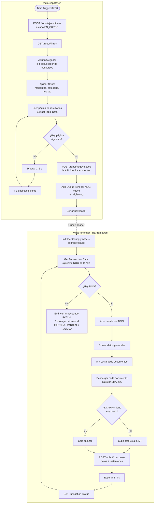

# 08 · Diseño del robot RPA

Plataforma: **UiPath** (Studio + Robot desatendido + Orchestrator). Ver [ADR-0002](adr/0002-plataforma-rpa.md).

## 8.1 Responsabilidad

El robot replica lo que hace una persona en Guatecompras: **buscar, abrir, leer y descargar**. No analiza ni notifica, y **no accede directamente a la base de datos**: entrega lo capturado a la **API del robot** (`/robot/*`), que registra los datos y encola los trabajos. Esto lo hace simple, auditable y reemplazable.

## 8.2 Procesos del robot

Se usa el patrón **Dispatcher / Performer** de UiPath con una Queue de Orchestrator.

| Proceso UiPath | Disparador (Orchestrator) | Entrada | Salida |
|---|---|---|---|
| `VigiaDispatcher` | Time Trigger, 02:00 | Filtros de perfiles activos y fecha de última ejecución (desde la API) | Un **Queue Item** por NOG nuevo en la cola `vigia-nog` |
| `VigiaPerformer` (REFramework) | Queue Trigger sobre `vigia-nog` | Un NOG por Transaction Item | Concurso, documentos e instantánea enviados a la API |
| `VigiaSeguimiento` (REFramework) | Time Trigger, al terminar la captura (≈ 04:00) | Concursos en seguimiento con cierre vigente (desde la API) | Instantáneas enviadas a la API, que detecta los cambios |
| Captura manual (CU-13) | El dashboard agrega un Queue Item a `vigia-nog` mediante la Orchestrator API | Un NOG | Un concurso capturado |

**Correspondencia de conceptos:**

| Concepto | En UiPath |
|---|---|
| Cada NOG a capturar | **Transaction Item** de la Queue `vigia-nog` (referencia = NOG, evita duplicados en la cola) |
| Programación diaria | **Time Trigger** de Orchestrator |
| Selectores centralizados | **Object Repository** (RNF-07) |
| Parámetros | `Data/Config.xlsx` + **Assets** de Orchestrator |
| Clave de la API del robot | **Credential Asset** (nunca en el proyecto) |
| Excepciones `RED`, `CAMBIO_ESTRUCTURA`, `PORTAL_CAIDO` | **System Exception** (con reintento) |
| Excepciones `NEGOCIO`, `ARCHIVO` | **Business Rule Exception** (sin reintento) |
| Bitácora | Logs de Orchestrator + registro de ejecución en la API (`EJECUCION_ROBOT`) |

## 8.3 Flujo detallado · captura diaria

Al recibir `POST /robot/concursos`, la API registra el concurso con estado `CAPTURADO` y encola `extraer-texto` en pg-boss.

## 8.4 API del robot

Contrato entre el robot UiPath y el sistema. Todas las rutas exigen el encabezado `X-Robot-Key` y HTTPS. Los cuerpos se validan con los mismos esquemas Zod del dominio.

| Método y ruta | Uso |
|---|---|
| `POST /robot/ejecuciones` | Abrir ejecución (`tipo`, `uipath_job_id`) → `id` |
| `PATCH /robot/ejecuciones/:id` | Cerrar ejecución con estado y contadores |
| `GET /robot/filtros` | Unión de filtros de perfiles activos y fecha desde |
| `POST /robot/nogs/nuevos` | Recibe NOG del buscador, devuelve los que no existen (RN-01) |
| `GET /robot/documentos/:sha256` | ¿Ya existe el documento? (RN-02) |
| `POST /robot/documentos` | Subir PDF (multipart) con NOG, nombre y hash |
| `POST /robot/concursos` | Registrar concurso + instantánea; encola `extraer-texto` |
| `GET /robot/seguimiento` | Concursos en seguimiento con cierre vigente |
| `POST /robot/concursos/:nog/instantaneas` | Enviar instantánea de revisión; la API compara y registra cambios |
| `POST /robot/ejecuciones/:id/errores` | Registrar error con captura de pantalla y HTML (multipart) |

En UiPath las llamadas se hacen con la actividad **HTTP Request** (paquete `UiPath.WebAPI.Activities`) dentro de flujos reutilizables en `Api/`.

## 8.5 Selectores centralizados

Todos los elementos del portal se definen en el **Object Repository** del proyecto (`.objects/`), organizados por pantalla: `Buscador` y `DetalleConcurso`. Si Guatecompras cambia su HTML, se corrige **un solo lugar** (RNF-07). Las URL del portal van en `Data/Config.xlsx`.

| Pantalla | Elementos (los selectores reales se levantan en la fase 3) |
|---|---|
| Buscador | Lista de modalidad, lista de categoría, fecha desde, botón buscar, tabla de resultados, enlace "Siguiente" |
| DetalleConcurso | Descripción, entidad, estado, fecha de presentación, pestaña "Documentos", enlaces de descarga |

> Guatecompras está construido en ASP.NET Web Forms (páginas `.aspx`), lo que implica *postbacks*, campos ocultos de estado (`__VIEWSTATE`) y paginación por eventos. Por eso el robot usa el navegador con las actividades de UI Automation, esperando a que cada postback termine (`Check App State` / *wait for ready*).

## 8.6 Manejo de excepciones

| Tipo | Ejemplo | Excepción UiPath | Acción | Alcance |
|---|---|---|---|---|
| `RED` | Tiempo de espera, error 5xx | System Exception | Reintento de la transacción (MaxRetryNumber = 3) con espera exponencial: 5 s, 10 s, 20 s | Paso / transacción |
| `CAMBIO_ESTRUCTURA` | Elemento no encontrado | System Exception (`SelectorNotFoundException`) | Captura + HTML, alerta al administrador | Ejecución (si ocurre en el buscador) o concurso |
| `ARCHIVO` | PDF corrupto o vacío | Business Rule Exception | Marcar documento, continuar | Documento |
| `NEGOCIO` | Concurso sin documentos | Business Rule Exception | Registrar concurso con advertencia | Concurso |
| `PORTAL_CAIDO` | Página de mantenimiento | System Exception | Detener el proceso; Orchestrator lo reprograma en 1 hora, máximo 3 veces | Ejecución |

**Estados de la ejecución:**

| Estado | Condición |
|---|---|
| `EXITOSA` | Sin errores |
| `PARCIAL` | Errores en concursos individuales, pero la búsqueda terminó |
| `FALLIDA` | No se pudo completar la búsqueda |

**Evidencia ante fallos:** en el estado *Set Transaction Status* del REFramework se toma `captura.png` (Take Screenshot) y `pagina.html` (`document.documentElement.outerHTML` con Inject Js Script), y se suben a `POST /robot/ejecuciones/:id/errores`. Quedan visibles desde el dashboard (CU-12); el log detallado queda además en Orchestrator.

## 8.7 Uso responsable del portal

| Práctica | Valor |
|---|---|
| Pausa entre solicitudes | 2–3 segundos, con variación aleatoria |
| Horario | 02:00–06:00 (baja demanda) |
| Concurrencia | 1 robot, 1 navegador, 1 pestaña |
| Identificación | Se documenta el correo de contacto en la bitácora del proyecto (UiPath usa el navegador instalado y no permite fijar un User-Agent propio sin extensiones) |
| Alcance | Solo información pública, sin iniciar sesión |
| Descargas | Solo documentos nuevos (por hash) |
| Datos masivos | Se obtienen de OCDS, **no** con el robot |
| Revisión | Consultar `robots.txt` y términos de uso del portal antes de la fase 3 y documentar el resultado aquí |

## 8.8 Configuración

**`Data/Config.xlsx`** (hoja *Settings*, valores no secretos):

| Nombre | Valor |
|---|---|
| `UrlBuscador` | por confirmar en la fase 3 |
| `PausaMinMs` | 2000 |
| `PausaMaxMs` | 3000 |
| `TimeoutMs` | 30000 |
| `ApiBaseUrl` | `https://<dominio>/robot` |
| `ColaNog` | `vigia-nog` |

**Assets de Orchestrator:**

| Asset | Tipo | Uso |
|---|---|---|
| `Vigia_ApiKey` | Credential | Clave para `X-Robot-Key` |
| `Vigia_ApiBaseUrl` | Text | Permite cambiar de entorno sin republicar |

`MaxRetryNumber` (3) se configura en la Queue `vigia-nog` y en *Config.xlsx*. Los horarios (02:00 captura, ≈ 04:00 seguimiento) se configuran en los Triggers de Orchestrator.

## 8.9 Versionado y publicación

- Los proyectos de UiPath Studio se guardan en `bot/` y se versionan en Git (integración Git de Studio). Se excluye la carpeta `.local/`.
- Se publica a Orchestrator desde Studio (*Publish* → feed del tenant) con versión semántica.
- Lenguaje de expresiones: **C#**.
