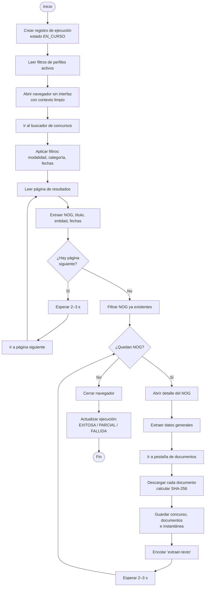

# 08 · Diseño del robot RPA

## 8.1 Responsabilidad

El robot replica lo que hace una persona en Guatecompras: **buscar, abrir, leer y descargar**. No analiza ni notifica; solo captura y deja trabajos en la cola. Esto lo hace simple, auditable y reemplazable.

## 8.2 Procesos del robot

| Proceso | Disparador | Entrada | Salida |
|---|---|---|---|
| `captura-diaria` | Programado, 02:00 | Filtros de perfiles activos, fecha de última ejecución | Concursos nuevos + documentos + trabajos de extracción |
| `revision-cambios` | Al terminar la captura | Concursos en seguimiento con cierre vigente | Cambios registrados + eventos de alerta |
| `captura-nog` | Manual (CU-13) | Un NOG | Un concurso capturado |

## 8.3 Flujo detallado · `captura-diaria`



## 8.4 Selectores centralizados

Todos los selectores del portal viven en `bot/src/selectors.ts`. Si Guatecompras cambia su HTML, se corrige **un solo archivo** (RNF-07).

```ts
// Ejemplo de estructura (los valores reales se levantan en la fase 3)
export const SEL = {
  buscador: {
    url: '/concursos/busquedaConcursos.aspx', // por confirmar
    modalidad: '#ddlModalidad',
    categoria: '#ddlCategoria',
    fechaDesde: '#txtFechaDesde',
    botonBuscar: '#btnBuscar',
    filasResultado: 'table#grdResultados tr.fila',
    paginaSiguiente: 'a:has-text("Siguiente")',
  },
  detalle: {
    titulo: '#lblDescripcion',
    entidad: '#lblEntidad',
    estado: '#lblEstatus',
    fechaCierre: '#lblFechaPresentacion',
    pestanaDocumentos: 'a:has-text("Documentos")',
    enlacesDocumentos: 'a[href*="descarga"]',
  },
} as const;
```

> Guatecompras está construido en ASP.NET Web Forms (páginas `.aspx`), lo que implica *postbacks*, campos ocultos de estado (`__VIEWSTATE`) y paginación por eventos. Por eso se usa un navegador real con Playwright en lugar de peticiones HTTP directas.

## 8.5 Manejo de excepciones

| Tipo | Ejemplo | Detección | Acción | Alcance |
|---|---|---|---|---|
| `RED` | Tiempo de espera, error 5xx | Excepción de Playwright / código HTTP | Reintento con espera exponencial: 5 s, 10 s, 20 s | Paso |
| `CAMBIO_ESTRUCTURA` | Selector no encontrado | `TimeoutError` en un selector obligatorio | Captura de pantalla + HTML, alerta al administrador | Ejecución (si ocurre en el buscador) o concurso |
| `ARCHIVO` | PDF corrupto o vacío | Tamaño 0 o error al leer cabecera | Marcar documento, continuar | Documento |
| `NEGOCIO` | Concurso sin documentos | Lista vacía | Registrar concurso con advertencia | Concurso |
| `PORTAL_CAIDO` | Página de mantenimiento | Texto o título conocido | Reprogramar en 1 hora, máximo 3 veces | Ejecución |

**Estados de la ejecución:**

| Estado | Condición |
|---|---|
| `EXITOSA` | Sin errores |
| `PARCIAL` | Errores en concursos individuales, pero la búsqueda terminó |
| `FALLIDA` | No se pudo completar la búsqueda |

**Evidencia ante fallos:** por cada error se guarda `captura.png`, `pagina.html` y la traza de Playwright (`trace.zip`), visibles desde el dashboard (CU-12).

## 8.6 Uso responsable del portal

| Práctica | Valor |
|---|---|
| Pausa entre solicitudes | 2–3 segundos, con variación aleatoria |
| Horario | 02:00–06:00 (baja demanda) |
| Concurrencia | 1 navegador, 1 pestaña |
| Identificación | User-Agent descriptivo con correo de contacto |
| Alcance | Solo información pública, sin iniciar sesión |
| Descargas | Solo documentos nuevos (por hash) |
| Datos masivos | Se obtienen de OCDS, **no** con el robot |
| Revisión | Consultar `robots.txt` y términos de uso del portal antes de la fase 3 y documentar el resultado aquí |

## 8.7 Configuración

```env
BOT_HORA_CAPTURA=02:00
BOT_PAUSA_MIN_MS=2000
BOT_PAUSA_MAX_MS=3000
BOT_REINTENTOS=3
BOT_TIMEOUT_MS=30000
BOT_HEADLESS=true
BOT_CONTACTO=correo@ejemplo.com
```

## 8.8 Equivalencia en UiPath (alternativa)

Si el curso exige una plataforma RPA comercial, el diseño se traslada así:

| Concepto en este diseño | UiPath |
|---|---|
| Proceso `captura-diaria` | Proceso con **REFramework** (Init → Get Transaction → Process → End) |
| Cola pg-boss | **Orchestrator Queues** o tabla en la base de datos |
| Cada NOG | **Transaction Item** |
| Excepción `CAMBIO_ESTRUCTURA` / `RED` | **System Exception** (reintento) |
| Excepción `NEGOCIO` | **Business Rule Exception** (sin reintento) |
| Selectores centralizados | **Object Repository** |
| Registro en la base de datos | Actividad HTTP Request a la API del sistema |
| Programación diaria | **Trigger** de Orchestrator |

El resto del sistema (API, IA, notificaciones, dashboard) no cambia.
