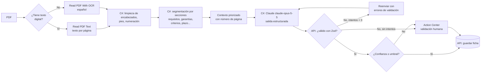

# 09 · Extracción con IA

## 9.1 Objetivo

Convertir bases de 30 a 80 páginas en una **ficha estructurada, validada y trazable**, y en un resumen que se lea en menos de un minuto.

## 9.2 Flujo

Todo el flujo lo ejecuta el robot **`VC.Analisis`** (ver [08 · Diseño de los robots](08-diseno-del-bot.md#85-vcanalisis--ejecutor-reframework--action-center)). La API valida y guarda; el robot no repite las reglas del esquema.



### Confianza de la ficha

La confianza **no la reporta el modelo**, porque ese dato no es confiable. La calcula la API con verificaciones objetivas, de 0 a 1:

| Verificación | Peso |
|---|---|
| La fecha límite de la ficha coincide con la fecha de cierre que el robot leyó del portal | 0.30 |
| El monto de la ficha coincide (±1 %) con el monto publicado en el portal, si existe | 0.20 |
| Cada página citada existe en el documento y contiene palabras del dato extraído | 0.30 |
| Hay al menos un requisito y un criterio de calificación | 0.20 |

Si no se puede hacer una verificación, ese componente se excluye y los pesos restantes se reescalan:
- El portal no publica el monto.
- Las bases no traen la fecha límite (rige la del portal).
- La cita apunta a una página escaneada, sin texto, que Claude leyó como PDF.

Una cita a una página que no existe sí cuenta como error. Si solo se pudo medir la completitud (por ejemplo, bases escaneadas y sin fecha), la confianza tiene un tope de 0.5 y la ficha va a revisión.

El umbral (por defecto 0.7) es configurable. Por debajo de él, la ficha va a Action Center con los campos propuestos para que una persona los corrija.

## 9.3 Esquema de la ficha

```ts
import { z } from 'zod';

export const Requisito = z.object({
  tipo: z.enum(['legal', 'tecnico', 'financiero', 'experiencia', 'otro']),
  descripcion: z.string(),
  documento: z.enum([
    'RTU', 'RGAE', 'PATENTE_EMPRESA', 'PATENTE_SOCIEDAD', 'SOLVENCIA_FISCAL',
    'DPI_REPRESENTANTE', 'NOMBRAMIENTO', 'FIANZA_SOSTENIMIENTO', 'FIANZA_CUMPLIMIENTO',
    'DECLARACION_JURADA', 'CARTA_DISTRIBUIDOR', 'REGISTRO_SANITARIO', 'EXPERIENCIA',
    'ESTADOS_FINANCIEROS', 'OTRO',
  ]).nullable(),
  obligatorio: z.boolean(),
  pagina: z.number().int().nullable(),
  posibleRestrictivo: z.boolean(),
  motivoRestrictivo: z.string().nullable(),
});

export const Ficha = z.object({
  resumen: z.string().max(600),
  objeto: z.string(),
  items: z.array(z.object({
    descripcion: z.string(),
    cantidad: z.number().nullable(),
    unidad: z.string().nullable(),
  })),
  montoEstimado: z.number().nullable(),
  moneda: z.literal('GTQ').nullable(),
  fechaLimiteOfertas: z.string().datetime().nullable(),
  plazoEntrega: z.string().nullable(),
  lugarEntrega: z.string().nullable(),
  requisitos: z.array(Requisito),
  garantias: z.array(z.object({
    tipo: z.string(),
    porcentaje: z.number().nullable(),
    pagina: z.number().int().nullable(),
  })),
  criteriosCalificacion: z.array(z.object({
    criterio: z.string(),
    ponderacion: z.number().nullable(), // puntos o porcentaje
    pagina: z.number().int().nullable(),
  })),
  formaPago: z.string().nullable(),
  observaciones: z.array(z.string()),
});
```

## 9.4 Instrucciones al modelo (prompt base)

```text
Eres un analista de compras públicas de Guatemala. Recibirás el texto de las bases
de un concurso publicado en Guatecompras, dividido por páginas con el formato [p. N].

Extrae la información en el esquema JSON indicado. Reglas:
1. Usa solo información presente en el texto. Si un dato no aparece, usa null.
2. Para cada requisito, garantía y criterio indica la página donde aparece.
3. Mapea cada requisito documental al código del catálogo; si no corresponde, usa OTRO.
4. Marca posibleRestrictivo = true solo si el requisito exige una marca específica,
   una experiencia inusualmente puntual o una condición que pocos proveedores
   podrían cumplir, y explica el motivo.
5. El resumen debe tener entre 3 y 5 oraciones en español sencillo: qué se compra,
   para quién, por cuánto, cuándo cierra y el requisito más exigente.
6. No interpretes la ley ni des recomendaciones legales.
```

Para adendas se usa un segundo prompt que recibe la ficha vigente y el texto de la adenda, y devuelve **qué cambió** en lenguaje natural más los campos modificados.

## 9.5 Control de costos

| Medida | Efecto |
|---|---|
| Enviar solo secciones relevantes, no el PDF completo | Reduce los tokens de entrada |
| Modelo y esfuerzo configurables por asset; bajar solo si la evaluación de 13.4 lo permite | Ver opciones y costos en [ADR-0005](adr/0005-ia-claude.md) |
| No re-analizar documentos con el mismo hash | Evita llamadas duplicadas |
| Presupuesto diario configurable (`IA_PRESUPUESTO_DIARIO_USD`) | Al superarlo, los trabajos se posponen (CU-03 FA-3) |
| Registrar tokens y costo por ficha | Métrica de costo para el informe |

**Estimación para el piloto** (a validar): ~USD 0.14 por ficha con `claude-opus-5-5` y ~USD 14 al mes para ~100 fichas (cálculo en [ADR-0005](adr/0005-ia-claude.md)). El costo real se medirá y reportará en la evaluación.

## 9.6 Cálculo de compatibilidad

**Puntaje preliminar (preselección con el boletín).** Antes de tener la ficha, la API calcula un puntaje con los datos del boletín: categoría (40) + palabras clave en la descripción (50, +10 si hay dos o más). Umbral 50: la categoría sola no basta, hace falta al menos una palabra clave. Implementado en `api/src/domain/preseleccion.ts`.

**Puntaje completo (con la ficha).** De 0 a 100, suma de componentes con pesos configurables:

| Componente | Peso | Cálculo |
|---|---|---|
| Categoría | 25 | La categoría del concurso está en las del perfil |
| Similitud de contenido | 30 | Similitud semántica (embeddings) entre los ítems del concurso y los productos del perfil, más coincidencia de palabras clave |
| Departamento | 10 | El lugar de entrega está en los departamentos del perfil |
| Monto | 15 | El monto está dentro del rango del perfil (proporcional si se acerca) |
| Requisitos | 20 | Proporción de requisitos documentales obligatorios que la empresa ya tiene vigentes |

```
puntaje = Σ (peso_i × valor_i)   donde valor_i ∈ [0, 1]
faltantes = requisitos.obligatorios.documento − documentos_vigentes(perfil)
```

Los pesos se ajustarán con las calificaciones del usuario durante el piloto (RF-COM-05).

## 9.7 Evaluación de la extracción

Ver el protocolo en [13 · Plan de pruebas](13-plan-de-pruebas.md#134-evaluación-de-la-extracción-con-ia): se compara la ficha de la IA contra una ficha llenada a mano para una muestra de 30–50 concursos, campo por campo.
