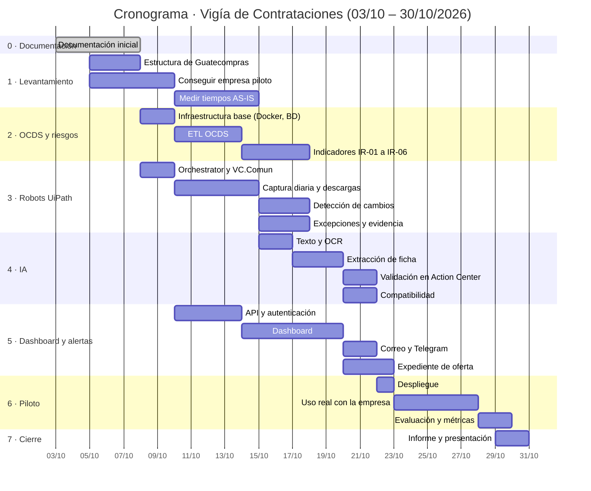

# 11 · Plan de proyecto

## 11.1 Metodología

Desarrollo **iterativo e incremental** en sprints de una semana. Cada fase termina con un entregable funcional que se puede demostrar.

## 11.2 Estructura de desglose del trabajo (EDT)

```mermaid
flowchart TD
    P[Vigía de Contrataciones]
    P --> F0[0. Documentación]
    P --> F1[1. Levantamiento AS-IS]
    P --> F2[2. Datos OCDS y riesgos]
    P --> F3[3. Robots UiPath]
    P --> F4[4. IA y compatibilidad]
    P --> F5[5. Dashboard y alertas]
    P --> F6[6. Piloto y evaluación]
    P --> F7[7. Cierre]

    F0 --> F0a[Problema y solución]
    F0 --> F0b[Requerimientos y casos de uso]
    F0 --> F0c[Arquitectura y modelo de datos]

    F1 --> F1a[Conseguir empresa piloto]
    F1 --> F1b[Medir tiempos actuales]
    F1 --> F1c[Levantar estructura de Guatecompras]

    F2 --> F2a[Infraestructura base]
    F2 --> F2b[ETL OCDS]
    F2 --> F2c[Indicadores IR-01 a IR-06]

    F3 --> F3o[Orchestrator: colas, assets, triggers]
    F3 --> F3l[Biblioteca VC.Comun y Object Repository]
    F3 --> F3a[VC.Captura: despachador]
    F3 --> F3b[VC.Concurso: detalle y descargas]
    F3 --> F3c[Detección de cambios]
    F3 --> F3d[Excepciones y evidencia]

    F4 --> F4a[VC.Analisis: texto y OCR]
    F4 --> F4b[Extracción de ficha]
    F4 --> F4v[Validación en Action Center]
    F4 --> F4c[Compatibilidad y faltantes]

    F5 --> F5a[API y autenticación]
    F5 --> F5b[Dashboard]
    F5 --> F5c[VC.Notificador: correo y Telegram]
    F5 --> F5e[VC.Expediente: robot atendido]

    F6 --> F6a[Despliegue]
    F6 --> F6b[Uso real 1 semana]
    F6 --> F6c[Medición de métricas]
    F6 --> F6d[Validación con experto en transparencia]

    F7 --> F7a[Informe final]
    F7 --> F7b[Presentación y demo]
    F7 --> F7c[Video]
```

## 11.3 Cronograma

Del **3 al 30 de octubre de 2026** (4 semanas). Las fases se traslapan: el desarrollo de los robots, la API y la carga OCDS avanza en paralelo, y el piloto se reduce a una semana de uso real.

| Hito | Fecha |
|---|---|
| Documentación aprobada | 07/10 |
| Primer robot (`VC.Captura`) publicado en Orchestrator | 14/10 |
| Primera ficha generada con IA | 19/10 |
| Sistema completo desplegado para el piloto | 22/10 |
| Fin del piloto | 27/10 |
| Entrega final | 30/10 |

## 11.4 Entregables

| Fase | Entregable | Criterio de aceptación |
|---|---|---|
| 0 | Documentación inicial (este repositorio) | Revisada por el catedrático |
| 1 | Informe AS-IS con tiempos medidos y carta de la empresa piloto | Mediciones de al menos 5 días |
| 2 | Base de datos OCDS cargada + reporte de indicadores | Consultas de IR-01 a IR-06 funcionando |
| 3 | Robots publicados en Orchestrator, ejecutando diariamente con bitácora | 7 días seguidos con ≥ 95 % de éxito |
| 4 | Fichas generadas + reporte de exactitud | ≥ 85 % de exactitud en la muestra |
| 5 | Dashboard, alertas y expediente funcionando | Casos de uso CU-05 a CU-10 y CU-16 demostrables |
| 6 | Reporte de evaluación del piloto | Métricas de [13](13-plan-de-pruebas.md) completas |
| 7 | Informe final, presentación y video demo | — |

## 11.5 Recursos

| Recurso | Detalle | Costo estimado |
|---|---|---|
| Desarrollador | Autor del proyecto | — |
| Computadora de desarrollo | Propia | — |
| Servidor del piloto | VPS básico o equipo propio encendido | Bajo |
| API de IA | Pago por uso, con presupuesto limitado | Bajo (ver [09](09-ia-extraccion.md#95-control-de-costos)) |
| UiPath | Studio + Automation Cloud (prueba; después Community): Orchestrator, 2 robots desatendidos | Q0 |
| Máquina Windows para robots | Computadora del autor durante desarrollo; definir para el piloto (R-13) | — |
| Dominio | Opcional | Bajo |
| Software | Código abierto o gratuito | Q0 |

## 11.6 Partes interesadas

| Parte | Interés | Participación |
|---|---|---|
| Catedrático | Evaluar el proyecto | Revisiones por fase |
| Empresa piloto | Ahorrar tiempo, ganar concursos | Mediciones, uso, retroalimentación, carta |
| Organización de transparencia | Herramientas de fiscalización | Validación del módulo de riesgos |
| Autor | Aprobar y exonerar el curso | Desarrollo completo |

## 11.7 Cómo conseguir la empresa piloto

1. Con los datos OCDS, listar proveedores **adjudicados en las categorías elegidas** durante el último año, priorizando MiPymes (montos moderados, varias adjudicaciones).
2. Filtrar por cercanía geográfica o por contactos en común.
3. Contactar con una propuesta breve: *uso gratuito durante el piloto a cambio de 15 minutos de retroalimentación por semana y una carta al finalizar*.
4. Alternativas: gestores de licitaciones, contactos personales, cámaras empresariales.

## 11.8 Estado al cierre (31/10/2026)

| Entregable | Estado |
|---|---|
| 0 · Documentación inicial | Completo y actualizado a UiPath |
| 1 · Informe AS-IS y carta de la empresa piloto | **Pendiente:** no se consiguió empresa piloto. Se presenta un escenario simulado, identificado como tal ([17.5](17-informe-de-resultados.md#175-escenario-simulado-de-piloto-empresa-ficticia)). |
| 2 · Base OCDS e indicadores | Completo para 2025–2026 (674 900 procesos, 6 indicadores) |
| 3 · Robots publicados y ejecutando a diario | Publicados y en operación desatendida desde el 31/10/2026; falta acumular 7 días de bitácora |
| 4 · Fichas y reporte de exactitud | Fichas reales generadas; falta la evaluación con 30–50 concursos |
| 5 · Dashboard, alertas y expediente | Completo: CU-05 a CU-16 demostrables |
| 6 · Evaluación del piloto | Pendiente (depende del entregable 1) |
| 7 · Informe final, presentación y video | [17 · Informe de resultados](17-informe-de-resultados.md), [18 · Guion de presentación](18-guion-de-presentacion.md); el video se graba siguiendo la demostración de 18.8 |

