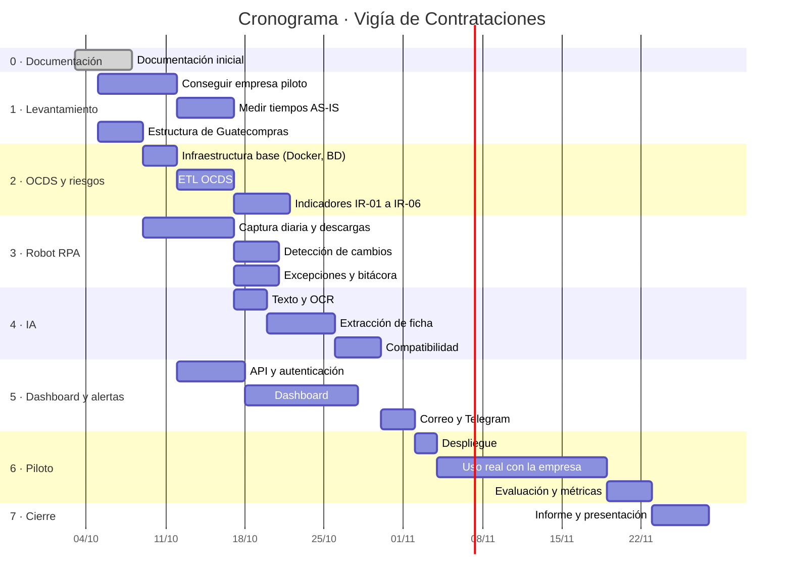

# 11 · Plan de proyecto

## 11.1 Metodología

Desarrollo **iterativo e incremental** en sprints de una semana. Cada fase termina con un entregable funcional que se puede demostrar.

## 11.2 Estructura de desglose del trabajo (EDT)

```mermaid
flowchart TD
    P[Vigía de Contrataciones]
    P --> F0[0. Documentación]
    P --> F1[1. Levantamiento AS-IS]
    P --> F2[2. Datos OCDS y riesgos]
    P --> F3[3. Robot RPA]
    P --> F4[4. IA y compatibilidad]
    P --> F5[5. Dashboard y alertas]
    P --> F6[6. Piloto y evaluación]
    P --> F7[7. Cierre]

    F0 --> F0a[Problema y solución]
    F0 --> F0b[Requerimientos y casos de uso]
    F0 --> F0c[Arquitectura y modelo de datos]

    F1 --> F1a[Conseguir empresa piloto]
    F1 --> F1b[Medir tiempos actuales]
    F1 --> F1c[Levantar estructura de Guatecompras]

    F2 --> F2a[Infraestructura base]
    F2 --> F2b[ETL OCDS]
    F2 --> F2c[Indicadores IR-01 a IR-06]

    F3 --> F3a[Captura diaria]
    F3 --> F3b[Descarga de documentos]
    F3 --> F3c[Detección de cambios]
    F3 --> F3d[Excepciones y bitácora]

    F4 --> F4a[Texto y OCR]
    F4 --> F4b[Extracción de ficha]
    F4 --> F4c[Compatibilidad y faltantes]

    F5 --> F5a[API y autenticación]
    F5 --> F5b[Dashboard]
    F5 --> F5c[Correo y Telegram]

    F6 --> F6a[Despliegue]
    F6 --> F6b[Uso real 2–3 semanas]
    F6 --> F6c[Medición de métricas]
    F6 --> F6d[Validación con experto en transparencia]

    F7 --> F7a[Informe final]
    F7 --> F7b[Presentación y demo]
    F7 --> F7c[Video]
```

## 11.3 Cronograma

_Ajustar las fechas al calendario real del curso._

## 11.4 Entregables

| Fase | Entregable | Criterio de aceptación |
|---|---|---|
| 0 | Documentación inicial (este repositorio) | Revisada por el catedrático |
| 1 | Informe AS-IS con tiempos medidos y carta de la empresa piloto | Mediciones de al menos 5 días |
| 2 | Base de datos OCDS cargada + reporte de indicadores | Consultas de IR-01 a IR-06 funcionando |
| 3 | Robot ejecutando diariamente con bitácora | 7 días seguidos con ≥ 95 % de éxito |
| 4 | Fichas generadas + reporte de exactitud | ≥ 85 % de exactitud en la muestra |
| 5 | Dashboard y alertas funcionando | Casos de uso CU-05 a CU-10 demostrables |
| 6 | Reporte de evaluación del piloto | Métricas de [13](13-plan-de-pruebas.md) completas |
| 7 | Informe final, presentación y video demo | — |

## 11.5 Recursos

| Recurso | Detalle | Costo estimado |
|---|---|---|
| Desarrollador | Autor del proyecto | — |
| Computadora de desarrollo | Propia | — |
| Servidor del piloto | VPS básico o equipo propio encendido | Bajo |
| API de IA | Pago por uso, con presupuesto limitado | Bajo (ver [09](09-ia-extraccion.md#95-control-de-costos)) |
| Dominio | Opcional | Bajo |
| Software | Todo de código abierto o gratuito | Q0 |

## 11.6 Partes interesadas

| Parte | Interés | Participación |
|---|---|---|
| Catedrático | Evaluar el proyecto | Revisiones por fase |
| Empresa piloto | Ahorrar tiempo, ganar concursos | Mediciones, uso, retroalimentación, carta |
| Organización de transparencia | Herramientas de fiscalización | Validación del módulo de riesgos |
| Autor | Aprobar y exonerar el curso | Desarrollo completo |

## 11.7 Cómo conseguir la empresa piloto

1. Con los datos OCDS, listar proveedores **adjudicados en las categorías elegidas** durante el último año, priorizando MiPymes (montos moderados, varias adjudicaciones).
2. Filtrar por cercanía geográfica o por contactos en común.
3. Contactar con una propuesta breve: *uso gratuito durante el piloto a cambio de 15 minutos de retroalimentación por semana y una carta al finalizar*.
4. Alternativas: gestores de licitaciones, contactos personales, cámaras empresariales.
