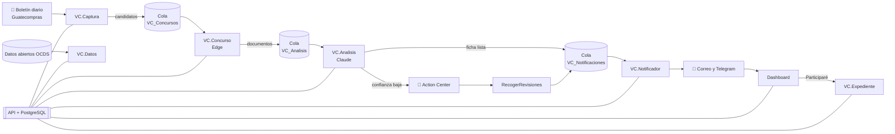

# 18 · Guion de presentación

Guion para presentar Vigía de Contrataciones a tres públicos a la vez:

- **Usted (el autor):** para entender y poder explicar cada pieza.
- **El catedrático y los compañeros:** quieren saber qué pasa detrás, cómo se conectan los robots y por qué se diseñó así.
- **Un cliente (una MiPyme):** quiere saber qué gana, cuánto le cuesta y qué tiene que hacer.

Cada parte trae **lo que se dice** (en cursiva, para leer o adaptar), **lo que se muestra** y **la explicación técnica** para responder preguntas. Las cifras son las del [informe de resultados](17-informe-de-resultados.md). Las del escenario simulado se dicen siempre como **simulación**.

**Duración sugerida:** 25 minutos de exposición + 10 de demostración + 10 de preguntas.

| Bloque | Minutos | Parte del guion |
|---|---|---|
| Problema y propuesta | 4 | 18.1 – 18.2 |
| Un día en la vida del sistema (el corazón) | 12 | 18.3 |
| Por qué no es 100 % automático y qué automatizamos | 3 | 18.4 |
| Arquitectura y decisiones técnicas | 4 | 18.5 |
| Resultados y valor para el cliente | 2 | 18.6 – 18.7 |
| Demostración en vivo | 10 | 18.8 |
| Preguntas | 10 | 18.9 |

---

## 18.1 Apertura: el problema

> *"Cada día, Guatecompras publica entre 850 y 2 000 concursos. Una MiPyme que le vende al Estado, por ejemplo una que vende computadoras o insumos médicos, tiene que entrar al portal, buscar, abrir concurso por concurso, descargar las bases, leer 30 o 40 páginas para saber si califica, revisar si hubo adendas y, cuando decide participar, reunir sus documentos y armar el expediente.*
>
> *Según nuestras estimaciones, eso son entre 5 y 12 horas al día de una persona. La mayoría de las MiPymes no tiene a alguien dedicado, así que revisa poco, llega tarde o pierde concursos por un documento vencido.*
>
> *Vigía de Contrataciones hace ese trabajo con robots de UiPath e inteligencia artificial. La persona solo interviene donde su criterio aporta valor."*

**Para el catedrático:** es un proceso **repetitivo, basado en reglas y de alto volumen**, las tres características que la literatura señala para elegir RPA. La parte que el RPA tradicional no resuelve, entender documentos no estructurados, la hace la IA. Esa combinación se llama **automatización inteligente**.

## 18.2 La solución en una frase y el mapa

> *"Cada mañana, el sistema le dice a la empresa qué concursos le sirven, qué piden, qué le falta y a qué precio se compró antes algo parecido. Si decide participar, le arma la carpeta de la oferta."*

**Se muestra** este mapa (también está en [05 · Arquitectura](05-arquitectura.md)):

> *"Hay seis robots. Cada uno hace una sola cosa y le pasa el trabajo al siguiente por una cola de Orchestrator. Ningún robot toca la base de datos: todos hablan con una API, que es donde viven las reglas del negocio. Y hay un dashboard donde la empresa ve todo."*

---

## 18.3 Un día en la vida del sistema, paso a paso

Esta es la parte central. Se cuenta **en orden cronológico**, como si fuera un día normal. En cada paso se dice quién lo hace, cómo se conecta con el siguiente y si el usuario interviene.

### Paso 0 · Antes de todo: el perfil de la empresa (una vez)

**Quién:** el usuario, en el dashboard (**Perfil de empresa**).

**Qué hace:** registra lo que vende (categorías y palabras clave como *computadora* o *tóner*), dónde puede entregar, el rango de montos, las modalidades y **los documentos que tiene con su fecha de vencimiento** (RTU, RGAE, patente, solvencia fiscal…). Opcionalmente vincula su Telegram.

> *"Esto se hace una vez. Con estos datos el sistema decide qué le interesa y calcula qué le falta para cada concurso."*

**Técnico:** `PUT /app/perfiles/:id` guarda el perfil y **recalcula la compatibilidad** de todos los concursos. Los pesos del puntaje son parámetros, no constantes (regla del proyecto): categoría 25, contenido 30, departamento 10, monto 15, requisitos 20.

**Vender:** *"Configurarlo toma 10 minutos. Desde ahí, el sistema trabaja para usted."*

### Paso 1 · 01:15 · Llega el boletín

**Quién:** Guatecompras, por correo.

**Qué pasa:** la cuenta del proyecto está suscrita al **Boletín diario de concursos**. Hacia la 01:15 llega un correo con todos los concursos publicados el día anterior (el 31/10/2026 fueron **850**), con el HTML en el cuerpo.

> *"No hacemos que un robot busque en el portal concurso por concurso. Guatecompras ya publica un resumen diario por correo y lo usamos. Es más rápido, más completo y respeta las protecciones del portal."*

**Técnico:** la búsqueda y el detalle del portal están protegidos con **Cloudflare Turnstile**, una señal de que el operador no quiere acceso automatizado masivo. El boletín por correo es un canal oficial. La decisión está en [ADR-0006](adr/0006-boletin-y-robot-atendido.md).

### Paso 2 · 06:00–12:00 · `VC.Captura` lee el boletín y elige candidatos

**Quién:** robot **desatendido, en segundo plano**, con un disparador de Orchestrator cada hora de 06:00 a 12:00. Si el boletín aún no llegó, termina sin error y lo intenta en la hora siguiente.

**Qué hace:**

1. `Get IMAP Mail Messages` lee el buzón (las credenciales están en el asset `VC_SMTP`, nunca en el código).
2. Un **coded workflow en C#** (`GuardarBoletinCorreo.cs` + `BoletinCorreo.cs`) interpreta el HTML: NOG, entidad, modalidad, descripción, categoría y fechas.
3. Envía los 850 concursos a la API: `POST /robot/boletin`.
4. La **API hace la preselección** con los perfiles activos: categoría, palabras clave en la descripción, modalidad y fecha de cierre vigente. Calcula un **puntaje preliminar** y devuelve los mejores, con un tope de **50 por día** (`PRESELECCION_MAX_DIARIO`).
5. El robot agrega cada candidato a la cola **`VC_Concursos`** (`Add Queue Item`, referencia `NUEVO-{NOG}-{fecha}`).

> *"De 850 concursos, el sistema se queda con los 50 que pueden interesarle a la empresa. Nadie tuvo que buscar."*

**Técnico:**

- **Por qué la preselección está en la API y no en el robot:** regla del proyecto. Las reglas de dominio viven en la API (validadas con Zod, con pruebas en Vitest); el robot solo transporta. Si mañana cambia la regla, no hay que republicar el robot.
- **Por qué XAML + C#:** XAML para la estructura y las actividades nativas (IMAP, colas); C# para transformar datos (parsear HTML), porque es más fácil de probar. El parser tiene **16 pruebas** con boletines reales (`dotnet test`).
- **Colas:** desacoplan los robots. Si `VC.Concurso` falla, los candidatos siguen en la cola y se reintentan.

### Paso 3 · 07:00 · Resumen preliminar

**Quién:** `VC.Notificador`, desatendido, disparador a las 07:00.

**Qué hace:** pide a la API el resumen (`GET /robot/notificaciones/resumen`). **La API decide qué y a quién**: oportunidades nuevas sobre el umbral del perfil, recordatorios de cierre (3 días y 1 día antes) y documentos que vencen en 30 días. El robot arma el correo HTML en C# (`PlantillaCorreo.cs`), lo envía por SMTP y, antes, manda la versión corta por **Telegram** (`PlantillaTelegram.cs`) a los chats vinculados. Cada envío se registra (`POST /robot/notificaciones`) para no repetir avisos.

> *"A las 7 de la mañana, el encargado ya tiene en su correo y en Telegram las oportunidades del día, ordenadas por compatibilidad."*

**Técnico:** las oportunidades se marcan como notificadas al registrar el envío: idempotencia. Si un envío falla, se registra como `FALLIDO` y los demás siguen.

### Paso 4 · 07:00–21:00 · `VC.Concurso` abre cada concurso y descarga los documentos

**Quién:** robot con interfaz (Edge). Corre **cada hora de 07:00 a 21:00 con el robot desatendido en la sesión abierta de la PC**, o la persona lo inicia desde UiPath Assistant. Toma tandas de 5 elementos.

**Qué hace**, por cada NOG de la cola (patrón **REFramework**: Init → Get Transaction Data → Process → Set Transaction Status):

1. Abre el detalle del concurso en **Edge**, el navegador normal de la persona (`Navigate To`).
2. **Comprueba que cargó** buscando el encabezado (`Check App State` sobre el elemento `Encabezado` del **Object Repository**).
   - **Si aparece la verificación de Cloudflare:** muestra un aviso y **espera a que la persona la resuelva**. **Nunca la resuelve solo.**
3. Lee los **datos generales** (HTML del contenedor `DatosGenerales`).
4. Hace clic en la pestaña **Historial de acciones**. Esa pestaña carga por AJAX, así que la URL no cambia. El robot espera hasta que aparezca la tabla de historial, que trae cada documento con su enlace y su fecha.
5. `DetallePortal.cs` interpreta el HTML: título, entidad, modalidad, estado, fecha de cierre y la lista de documentos. Completa los enlaces relativos con el dominio del portal.
6. Envía el detalle a la API (`PUT /robot/concursos/:nog/detalle`). La API **compara con la lectura anterior** y registra los cambios (nuevo documento, nueva fecha, nuevo estado, aclaraciones). Devuelve qué documentos ya tiene, por **hash SHA-256**, para no descargarlos otra vez.
7. Descarga solo los documentos nuevos y los sube a la API.
8. Encola el NOG en **`VC_Analisis`** y, si hubo cambios en un concurso que alguien sigue, en **`VC_Notificaciones`**.
9. Pausa de 2 a 3 segundos entre acciones: uso responsable del portal.

> *"Este robot hace lo que haría una persona: abre el concurso, va al historial y descarga las bases. Solo abre los candidatos, no los 850, y solo descarga lo nuevo."*

**Técnico:**

- **Object Repository:** todos los selectores del portal están en un solo lugar (aplicación *Guatecompras*, pantalla *DetalleConcurso*). Si el portal cambia, se corrige ahí.
- **Excepciones:**
  - *Business Rule Exception* cuando el concurso no tiene documentos: no se reintenta.
  - *System Exception* cuando falla la red o una descarga: Orchestrator reintenta el elemento.
  - Un cambio de estructura del portal se detecta con un mensaje `CAMBIO_ESTRUCTURA` (probado).
- **Medido:** 15 concursos y 23 documentos reales. Una tanda de 5 concursos toma unos 4 minutos. **El portal no pidió verificación en ninguna ejecución.**

### Paso 5 · `VC.Analisis` lee las bases con IA y arma la ficha

**Quién:** robot desatendido en segundo plano, con **disparador de cola**: arranca solo cuando llega un elemento a `VC_Analisis`.

**Qué hace:**

1. Descarga de la API los documentos del concurso.
2. Extrae el texto de los PDF (`Read PDF Text`) y lo marca por página (`[p. N]`). Si una página casi no tiene texto, el PDF es escaneado y se envía **completo a Claude como PDF**, que lo lee como imagen.
3. Revisa el **presupuesto diario de IA** en la API (tope de US$ 2). Si se agotó, pospone el elemento al día siguiente.
4. Llama a **Claude** (`claude-opus-5-5`) desde un coded workflow en C# con el SDK oficial, con **salida estructurada**: le pasa el **JSON Schema de la ficha**, generado desde el esquema Zod de la API, así que la respuesta tiene exactamente la forma esperada.
5. Valida la ficha en la API (`POST /robot/fichas/validar`). Si algo no cumple, reintenta mostrándole a Claude los errores (hasta 3 veces).
6. La API **calcula la confianza**. El modelo no la reporta, porque no es confiable que se califique a sí mismo. La calcula con verificaciones objetivas:
   - ¿La fecha límite coincide con la del portal? (peso 0.30)
   - ¿El monto coincide? (0.20)
   - ¿Cada página citada existe y contiene las palabras del requisito? (0.30)
   - ¿Hay requisitos y criterios? (0.20)
   - Lo que no se puede verificar (por ejemplo, páginas escaneadas) se excluye.
7. Con confianza **≥ 0.7**, la ficha queda **ANALIZADO** y va a `VC_Notificaciones`.
8. Con confianza **< 0.7**, crea una **tarea en Action Center** con la ficha propuesta y se la **asigna** al revisor (`VC_RevisorFichas`).

> *"La IA lee las 40 páginas por usted y le dice en 5 oraciones qué se compra, cuánto, cuándo cierra y qué piden, con la página donde aparece cada cosa. Y no le creemos a ciegas: si no podemos comprobar algún dato, una persona lo revisa."*

**Técnico:**

- **Por qué salida estructurada + Zod:** el esquema es la única fuente de verdad. Se define en TypeScript, se exporta como JSON Schema para Claude y la misma definición valida la respuesta en la API.
- **Por qué la confianza la calcula la API:** es una decisión explícita ([09 · IA](09-ia-extraccion.md)); la autocalificación de un modelo no es una métrica.
- **Costo medido:** US$ 0.15–0.20 por concurso con bases completas; US$ 0.05 con pocos documentos.
- **Medido:** el 65 % de los documentos reales son escaneados. Por eso hoy muchas fichas pasan por revisión, y por eso se ajustó la confianza el 31/10.

### Paso 6 · Validación humana en Action Center

**Quién:** **el usuario** (o el analista), en Action Center.

**Qué hace:** recibe la tarea "Validar ficha · NOG …" ya asignada. Compara con las bases, corrige lo que haga falta y aprueba.

**Después:** cada 30 minutos `VC.Analisis.RecogerRevisiones` (desatendido) lee las tareas completadas, guarda la ficha como **validada por una persona** (`HUMANO`) y la encola para avisar. Es idempotente: si corre dos veces, no duplica.

> *"Aquí está la diferencia entre una herramienta seria y una que inventa: cuando la IA no está segura, decide una persona. Es lo que en automatización se llama human in the loop."*

**Medido:** 5 tareas reales creadas, aprobadas y recogidas automáticamente.

### Paso 7 · Compatibilidad completa y aviso de la ficha

**Quién:** la API calcula y `VC.Notificador` avisa (disparador de la cola `VC_Notificaciones`).

**Qué pasa:** con la ficha guardada, la API calcula la **compatibilidad completa** de cada perfil. Ahora sí considera los requisitos de las bases contra los **documentos vigentes al cierre** de la empresa y calcula los **faltantes**. Si el puntaje supera el umbral del perfil, `VC.Notificador` manda por correo y Telegram la ficha, lo que falta y los requisitos posiblemente restrictivos. Si el concurso ya estaba en seguimiento y cambió, manda el aviso de cambio.

> *"El aviso no dice solo 'hay un concurso'. Dice 'hay un concurso de computadoras de COPADEH, cierra el 3 de noviembre y te falta la solvencia fiscal porque vence antes'."*

### Paso 8 · El usuario revisa en el dashboard

**Quién:** **el usuario**.

**Qué ve:**

- **Oportunidades:** la lista ordenada por puntaje.
- **Detalle:** la ficha, por qué tiene ese puntaje, qué le falta, los documentos sin ir a Guatecompras y las **compras anteriores parecidas** (datos abiertos: quién ganó y por cuánto).
- **Historial:** búsqueda en 674 900 procesos.
- **Banderas rojas:** señales de riesgo en el histórico.

Puede **Seguir**, **Participaré** o **Descartar**, y calificar la alerta (👍/👎).

> *"Antes, saber a qué precio se adjudicó algo parecido le tomaba una hora al gerente, cuando lo hacía. Aquí está en la misma pantalla."*

### Paso 9 · "Participaré" arma el expediente

**Quién:** el usuario presiona **Participaré**. Lo demás es automático.

**Qué pasa:**

1. La API guarda el seguimiento y, si la ficha está lista, **pide a Orchestrator** que inicie `VC.Expediente` con `in_Nog`, `in_PerfilId` e `in_Desatendido = True`.
2. El robot desatendido pide a la API el **checklist**: cada requisito como Listo, Faltante, Vencido o Revisar, contra los documentos vigentes al cierre.
3. Crea `Expediente_{NOG}` con:
   - `01 Bases del concurso`, desde el almacén de la API, sin volver al portal.
   - `02 Documentos de la empresa`, copiados de `_DocumentosEmpresa`, **solo los vigentes**.
   - `Checklist.xlsx`.
   - `03 Borradores`: carta de presentación y declaración jurada en Word, con los datos de la empresa.
4. Registra el expediente en la API con su duración. A los segundos aparece en la página del concurso.

> *"Armar la carpeta de una oferta le toma a una persona entre una y dos horas. Aquí toma unos segundos desde que presiona 'Participaré'. La persona revisa el checklist y completa los borradores."*

**Técnico:** Excel y Word se generan en C# escribiendo **Office Open XML** directamente (`ArchivosOffice.cs`). No se necesita Office instalado ni paquetes externos, y tiene 11 pruebas. El mismo robot funciona atendido desde Assistant, con preguntas y resumen.

### Paso 10 · Domingo 02:30 · `VC.Datos` actualiza los datos abiertos

**Quién:** robot desatendido, disparador semanal.

**Qué hace:** pide a la API la carga del histórico **OCDS** (estándar internacional de contrataciones abiertas). La API descarga los archivos anuales del **OCP Data Registry**, los carga en flujo a PostgreSQL y recalcula las **banderas rojas**. El robot vigila el avance cada minuto y, si falla, avisa por correo al administrador.

> *"Los datos históricos no se sacan con el robot del portal. Se toman de los datos abiertos oficiales: es la fuente correcta, completa y sin carga para el portal."*

**Técnico:** separar RPA de datos abiertos es la decisión fundacional del proyecto ([ADR-0001](adr/0001-rpa-y-datos-abiertos.md)). El robot se usa solo donde no hay datos estructurados (detalle y documentos). Banderas calculadas: IR-01, 02, 03, 04, 05 y 08 con SQL (funciones de ventana para el fraccionamiento). IR-06 no es calculable con los datos publicados ([ADR-0007](adr/0007-fuente-ocds.md)). **Siempre con el aviso de que son señales, no acusaciones.**

### Paso 11 · Supervisión

**Quién:** el administrador, en **Ejecuciones**.

**Qué ve:** cada trabajo de Orchestrator con su duración y lo que produjo (concursos, documentos, fichas, costo de IA, avisos y expedientes), y la tasa de éxito frente a la meta de 95 %. Puede **ejecutar ahora** cualquier proceso y **capturar un NOG a mano** para un concurso que no vino en el boletín. Ese NOG entra a `VC_Concursos` con prioridad alta y sigue el mismo camino.

**Técnico:** la API consulta Orchestrator con la External Application (OAuth2 *client credentials*) y copia los trabajos a la tabla `ejecucion_robot`. Los robots no tienen que reportar nada extra: **Orchestrator es la fuente de verdad** de las ejecuciones.

---

## 18.4 ¿Por qué no es 100 % automático? Y qué automatizamos

> *"Una pregunta justa es: si es automatización, ¿por qué hay una persona? Porque automatizamos todo lo que se puede automatizar sin hacer trampa y sin perder calidad. Quedan tres momentos humanos, y cada uno tiene una razón."*

| Momento humano | Por qué existe | Qué hicimos para reducirlo |
|---|---|---|
| **Verificación de Cloudflare** en el portal | El operador del portal la puso para que no entren robots masivos. Resolverla automáticamente sería evadir una protección: no es ético ni legal, y en un proyecto académico es inaceptable. | Usamos el boletín por correo (sin captcha) para descubrir; abrimos solo candidatos (50, no 850); usamos el navegador normal de la persona. El robot corre solo cada hora y **solo pide ayuda si aparece la verificación**. En la operación real no apareció ni una vez. |
| **Validar fichas dudosas** en Action Center | Una IA puede equivocarse. Si no podemos comprobar un dato contra el portal o el texto, decide una persona. | La tarea llega **asignada**. La confianza excluye lo que no se puede verificar (escaneados) en vez de castigarlo. La decisión se recoge sola cada 30 minutos. |
| **Decidir participar** | Es una decisión de negocio de la empresa. | Al presionar *Participaré*, **el expediente se arma solo**. |

**Lo que automatizamos el 31/10/2026** ([ADR-0008](adr/0008-automatizar-pasos-atendidos.md)):

1. **`VC.Concurso`** ya no espera a que alguien lo inicie: corre cada hora en la sesión abierta de la PC.
2. **`VC.Expediente`** se inicia desde el dashboard al marcar *Participaré*, sin abrir UiPath Assistant.
3. **La asignación de tareas** de Action Center es automática.

**Lo que deliberadamente no automatizamos:**

- El captcha.
- La aprobación de fichas dudosas.
- La **presentación de la oferta** en Guatecompras: requiere el usuario y la firma del proveedor, y es su responsabilidad legal.

---

## 18.5 Arquitectura y decisiones técnicas (para el ingeniero)

### Principios

1. **UiPath es el centro** ([ADR-0004](adr/0004-uipath-como-centro.md)): Orchestrator programa, encola, guarda credenciales y supervisa; Action Center pone a la persona en el ciclo.
2. **Una responsabilidad por proceso**, conectados por **colas**. Cada robot se puede reintentar, escalar o reemplazar sin tocar a los demás.
3. **Los robots no tocan la base de datos.** Todo pasa por la API (`/robot/*`, con clave de robot). Las reglas de dominio están en un solo lugar y con pruebas.
4. **Secretos solo en `.env` y en assets de Orchestrator**, nunca en `Config.json` ni en los flujos. El Workflow Analyzer exige leer las credenciales junto a donde se usan (ST-SEC-008).
5. **Datos históricos desde OCDS, nunca con el robot.**
6. **Parámetros, no constantes:** umbrales, pesos, presupuesto y topes son configurables.

### Capas

| Capa | Tecnología | Responsabilidad |
|---|---|---|
| Automatización | UiPath Studio 2026 (XAML + coded workflows C#, .NET 10), REFramework, Object Repository | Portal, correo, archivos, IA, avisos |
| Orquestación | Orchestrator (colas, disparadores de tiempo y de cola, assets, robot desatendido), Action Center | Programar, desacoplar, reintentar, validar |
| Dominio | API Node 24 + Fastify 5 + Prisma 7 + Zod 4 | Preselección, compatibilidad, confianza, presupuesto de IA, cambios, riesgos, avisos |
| Datos | PostgreSQL 16 + pgvector (Docker) | Concursos, documentos, fichas, perfiles, OCDS, bitácora |
| Presentación | Angular 22 + Angular Material | Dashboard |
| IA | Claude `claude-opus-5-5`, salida estructurada | Ficha de las bases |

### Decisiones que conviene defender

| Pregunta | Respuesta corta | Documento |
|---|---|---|
| ¿Por qué no Playwright o Selenium? | La primera versión era Playwright y el RPA quedaba en segundo plano. El curso exige UiPath y la automatización debe ser el centro: orquestación, colas, validación humana y gobierno. | ADR-0002 → ADR-0004 |
| ¿Por qué boletín por correo? | El portal protege búsqueda y detalle con captcha; el boletín es un canal oficial y completo. | ADR-0006 |
| ¿Por qué Claude? | Salida estructurada con esquema, lectura nativa de PDF escaneados, buen español; costo controlado con presupuesto diario. | ADR-0005 |
| ¿Por qué C# dentro de UiPath? | Para transformar datos (parsers, plantillas, Excel/Word) con pruebas unitarias; XAML para el flujo y las actividades nativas. | 08 |
| ¿Cómo evitan duplicados? | NOG único, hash SHA-256 por documento y registro de avisos enviados. | 07 |
| ¿Qué pasa si el portal cambia? | Selectores centralizados en el Object Repository; el parser falla con `CAMBIO_ESTRUCTURA` y Orchestrator lo reporta. | 08 |
| ¿Y si la IA alucina? | Esquema obligatorio, validación con Zod, reintentos con errores, confianza objetiva, citas de página y revisión humana bajo 0.7. | 09 |

### Calidad

- **76 pruebas** de la API (Vitest, contra PostgreSQL real) y **pruebas xUnit** de cada coded workflow: parser del boletín (16), lectura del portal con páginas reales guardadas (30), plantillas de correo y Telegram (9), expediente (11) y extracción con IA.
- Workflow Analyzer en cada XAML antes de publicar.
- 20 casos de prueba del plan: 17 pasan completos, 2 parciales y 1 no observado (captcha). Detalle en [17.3](17-informe-de-resultados.md#173-casos-de-prueba).

---

## 18.6 Resultados (cifras reales)

> *"Esto no es una maqueta: corrió con datos reales de Guatecompras."*

- Boletín real del 31/10/2026: **850 concursos → 50 candidatos**.
- **15 concursos** leídos del portal, **23 documentos** reales (65 % escaneados), **0 verificaciones** de captcha.
- **11 fichas** reales con Claude, a **US$ 0.05–0.20** por concurso; 5 validadas en Action Center y recogidas solas.
- Avisos reales por correo y Telegram.
- **Expediente en 8–20 segundos.**
- **674 900 procesos** OCDS, **6 indicadores de riesgo**.

> *"Lo que falta para cerrar los objetivos es medir con una empresa real: 7 días de operación continua, exactitud con 30 a 50 fichas y el tiempo antes y después. El protocolo está listo."*

**Sea transparente:** no hubo empresa piloto. El escenario de [17.5](17-informe-de-resultados.md#175-escenario-simulado-de-piloto-empresa-ficticia) es una **simulación con empresa ficticia**: tiempos manuales estimados y tiempos del sistema medidos. Diga así: *"En un escenario simulado, con los tiempos manuales que estimamos y los del sistema que medimos, la reducción sería de 84 % a 93 %. Confirmarlo con una empresa real es el siguiente paso."*

## 18.7 Cómo venderlo al cliente

> *"Deje de buscar en Guatecompras. Cada mañana recibe las oportunidades que le sirven, lo que piden y lo que le falta."*

| Lo que le preocupa al cliente | Lo que le decimos |
|---|---|
| "No tengo tiempo de revisar el portal" | El sistema revisa todo el boletín por usted y le manda solo lo que le sirve, a las 7 de la mañana, por correo y Telegram. |
| "Pierdo concursos por un papel vencido" | Le avisamos 30 días antes de que venza cada documento y, en cada concurso, qué le falta al cierre. |
| "Leer las bases me toma horas" | La ficha resume las bases en 5 oraciones, con la página de cada requisito. |
| "No sé a qué precio ofertar" | Le mostramos a quién y a qué precio se adjudicó antes algo parecido. |
| "Armar el expediente es un dolor" | Presione *Participaré* y la carpeta está lista: bases, sus documentos vigentes, checklist y borradores. |
| "¿Y si la IA se equivoca?" | Cada dato trae su página; lo dudoso lo revisa una persona; y siempre le recordamos confirmar en el documento oficial. |
| "¿Es legal?" | Solo información pública, el boletín oficial y datos abiertos; respetamos las protecciones del portal y no presentamos ofertas por usted. |

**Modelo:** suscripción mensual por perfil de empresa, con un plan gratuito limitado a una categoría ([02 · Propuesta](02-propuesta-de-solucion.md#26-modelo-de-valor-cómo-se-ofrece)). El costo variable más visible es la IA: **menos de US$ 1 por día** para una empresa típica, con tope configurable.

**Retorno (ejemplo para explicar el cálculo, no medición):** si el encargado ahorra 4 horas al día y su hora cuesta Q 50, son unos **Q 4 000 al mes** de tiempo liberado, sin contar los concursos que antes no veía.

---

## 18.8 Guion de la demostración en vivo

**Antes de empezar (checklist):**

- [ ] Docker Desktop encendido; API (`npm start` en `api`) y dashboard (`npm start` en `web`) corriendo.
- [ ] UiPath Assistant conectado; la PC con la sesión abierta.
- [ ] Orchestrator, Action Center y la carpeta `C:\Vigia\Expedientes` abiertos en pestañas.
- [ ] Telegram abierto en el teléfono o en la PC.
- [ ] Un concurso con ficha lista para marcar *Participaré* (por ejemplo, NOG 32557469).

**Recorrido (10 minutos):**

1. **Correo del boletín** (1 min): *"Esto llega cada madrugada: 850 concursos."*
2. **Orchestrator → Queues → `VC_Concursos`** (1 min): *"De 850, 50 candidatos. Cada uno es un elemento de cola."* Mostrar los disparadores: *"Nadie inicia estos robots."*
3. **Dashboard → Oportunidades** (1 min): ordenadas por puntaje; preliminar contra completo.
4. **Detalle de un concurso** (2 min): ficha, página de cada requisito, *Te falta*, *Compras anteriores parecidas*.
5. **Action Center** (1 min): una tarea asignada; explicar la confianza.
6. **Participaré** (2 min): presionarlo, abrir Orchestrator → Jobs (aparece `VC.Expediente`), luego la carpeta con el checklist y los borradores. Recargar el detalle: aparece *Expediente de oferta*.
7. **Telegram** (30 s): un aviso recibido.
8. **Banderas rojas** (1 min): un proceso con IR-01 y su evidencia. *"Son señales, no acusaciones."*
9. **Ejecuciones** (30 s): bitácora y tasa de éxito; **Capturar un NOG** a mano.

**Plan B** si falla algo en vivo:

- Si Orchestrator tarda: mostrar la bitácora de **Ejecuciones** con los trabajos ya corridos.
- Si el portal pide verificación: *"Justo esto es lo que no automatizamos"*. Resolverla y continuar.
- Si no hay internet: mostrar las fichas, expedientes y avisos ya generados (están en la base y en `C:\Vigia\Expedientes`).

---

## 18.9 Preguntas probables y respuestas

| Pregunta | Respuesta |
|---|---|
| ¿Por qué no consumen una API de Guatecompras? | Para lo histórico sí: OCDS. Para el detalle y los documentos del día no hay API pública; por eso RPA. |
| ¿Qué pasa si se apaga la PC? | Los elementos esperan en las colas y se procesan al volver. En producción, el robot iría en una VM. |
| ¿Cuántos robots necesitan? | Uno desatendido (licencia Community): Orchestrator ejecuta los trabajos de uno en uno. |
| ¿Cómo saben que la ficha es correcta? | Confianza objetiva contra el portal y el texto, citas de página y revisión humana bajo 0.7. La exactitud se medirá con 30–50 fichas. |
| ¿Cuánto cuesta la IA? | US$ 0.05–0.20 por concurso; tope diario de US$ 2. |
| ¿Por qué la confianza excluye las páginas escaneadas? | Porque no tener texto con qué comparar no significa que la IA se equivocó. Sin ninguna verificación posible, la confianza se limita a 0.5 y la ficha va a revisión. |
| ¿Qué pasa si el portal cambia su HTML? | Falla con `CAMBIO_ESTRUCTURA`, Orchestrator lo marca y se corrige el selector en el Object Repository o el parser, que tienen pruebas con páginas reales. |
| ¿Cómo evitan avisos repetidos? | Cada envío se registra y la oportunidad se marca como notificada. |
| ¿Por qué Telegram? | Muchas MiPymes viven en el teléfono. Se vincula por perfil con un enlace de un solo uso, sin compartir contraseñas. |
| ¿Por qué el expediente no sube los documentos a la nube? | Son documentos sensibles de la empresa; se quedan en su carpeta local y solo se copian los vigentes. |
| ¿Las banderas rojas acusan a alguien? | No. Son señales estadísticas para revisar, y así se presentan siempre. |
| ¿Por qué no hubo piloto? | No se consiguió una empresa a tiempo. El protocolo y las herramientas de medición (bitácora, calificación de alertas, duración del expediente) están listos; el escenario mostrado es simulado y se dice así. |

## 18.10 Cierre

> *"Vigía de Contrataciones toma un proceso que hoy consume horas de una persona, buscar, leer, comparar y armar, y lo convierte en un aviso cada mañana y una carpeta lista cuando decides participar. Lo hace con robots de UiPath que trabajan solos, con IA que lee las bases y con una persona que decide donde importa. Y lo hace respetando el portal: sin evadir protecciones, con datos abiertos para lo histórico y diciendo siempre que las señales de riesgo son señales, no acusaciones. Gracias."*

---

## Apéndice · Vocabulario para explicarlo sin tecnicismos

| Término | Cómo explicarlo |
|---|---|
| RPA / robot | Un programa que usa las aplicaciones como lo haría una persona: abre el navegador, hace clic, descarga. |
| Orchestrator | El jefe de los robots: decide cuándo corre cada uno, les reparte el trabajo y guarda sus contraseñas. |
| Cola | Una bandeja de pendientes: un robot deja trabajo y otro lo toma. Si algo falla, el pendiente no se pierde. |
| Disparador | La alarma que inicia un robot a una hora o cuando llega trabajo a una cola. |
| Atendido / desatendido | Atendido: corre en la PC de la persona, que lo inicia. Desatendido: corre solo, programado por Orchestrator. |
| Action Center | La bandeja de tareas donde una persona aprueba lo que el robot no pudo decidir. |
| REFramework | La plantilla de UiPath para procesar pendientes de una cola con reintentos y manejo de errores. |
| Object Repository | El catálogo de los botones y campos del portal que el robot sabe reconocer. |
| Salida estructurada | Pedirle a la IA que responda llenando un formulario exacto, no con texto libre. |
| OCDS | El formato internacional en que los gobiernos publican sus compras como datos abiertos. |
| Human in the loop | Diseñar el proceso para que una persona decida en los puntos de duda. |
